# src/view/knowledge 架构

本目录只维护这一份说明。设计与契约直接编辑本文；文件清单、类图和导航由 [架构脚本](../../../scripts/source-architecture.mjs) 更新，生成区域之外的人工说明会保留。

## 封装意图

知识问题、预览提交、静态表单与共用来源说明。展示当前、退役、待采纳及待核实状态，不从路径或正文相同猜来源连续；来源组件无提交副作用。固定编辑基线，不要求真人维护声明，业务架构展示位于workspace。 Agent 编辑可保存本机默认引擎/模型，已有岗位不自动采纳。 动态架构表单先按对应IPC Schema核实；本地数据选择为封闭类别。

## 类与模块的设计意图

下表依据源码声明及文件头说明定位封装。字段表示该实例持有的状态或协作引用，不表示它拥有被引用服务的生命周期；实际资源责任和调用限制见下文契约及源码注释。

| 类／模块 | 实现形式与实例字段 | 封装依据 |
| --- | --- | --- |
| [ArchitectureEditor.tsx](ArchitectureEditor.tsx) | 组件模块 | 界面填写领域字段，不让用户手工拼目录/索引；固定打开时的知识版本，后端校验并保存计划，避免后台刷新覆盖草稿或跨版本误提交。 |
| [GovernanceLaunch.tsx](GovernanceLaunch.tsx) | 组件模块 | 入口移入根菜单，状态留在页面；保留同一次启动门禁和未知回执，不因关闭菜单重复执行。 |
| [knowledge-file-tree.ts](knowledge-file-tree.ts) | 函数／契约模块 | 目录/文件只反映知识路径，不伪造业务继承；限定根和安全分段，搜索保留匹配项的父链，坏 JSON 仍能定位修正。 |
| [KnowledgeFilePreview.tsx](KnowledgeFilePreview.tsx) | 组件模块 | 完整快照自动提供格式诊断；草稿固定起始版本、延迟完整预览，迟到结果不覆盖新编辑。提交后未知结果锁定原请求，不能换 ID 猜测重做。 |
| [KnowledgeFileTree.tsx](KnowledgeFileTree.tsx) | 组件模块 | 折叠是局部查看状态，选择只通知宿主；树本身不查询、编辑或登记负责人。 |
| [KnowledgeSourceDetails.tsx](KnowledgeSourceDetails.tsx) | 组件模块 | 内容相同不能证明对象没有被替换；将历史采纳与当前核实分开呈现，不由界面建立代次或自动迁移关系。 |
| [static-owners.ts](static-owners.ts) | 函数／契约模块 | 小组可仅由空目录或辅助正文组成，没有自身 skills.json；优先纳入同版本规则索引，再从定义路径补齐祖先，避免下拉框丢失合法归属。这里只读取静态快照。 |

## 接口设计契约

##### 架构根菜单治理

useGovernanceLaunch 持有显式启动门禁；TreeActions 关闭不销毁它。结果独立展示，回执未知不自动重发，切换工作区隔离迟到响应。KnowledgeFileTree 的行菜单复用无业务状态的 TreeActions；团队与业务模块各有专门的语义导航。

##### 单一树根与视图图标

文件预览与架构编辑中的关闭、编辑、移除和添加源目录也复用公共 Icon；表单边框、焦点和字号由统一界面规则提供，布局与知识事务仍属于本目录。

每棵树只保留业务模块/团队架构一个根，展开和折叠全部在树右上角用图标显示，title和aria-label提供提示。操作仅更新本地closed集合；根的行尾菜单持续可用，搜索时仍展开匹配祖先，不把折叠当知识修改。

##### 目录行尾操作

KnowledgeFileTree 的名称按钮后紧跟展开箭头，右侧竖向更多菜单只显示宿主为真实目录节点声明的动作。文件不自动得到模块/团队操作；回调捕获本行路径，不依赖右侧当前选中节点。图标操作保留 title 与 aria-label，Escape 关闭后回到菜单入口，点击外部关闭；树不查询/写知识或授予权限。选择、展开、菜单分开，320px长名称省略但路径可悬停查看。

### 静态架构编辑

`ArchitectureEditor` 从打开时的知识快照填入 Agent、Module、Skill 或 Workflow 表单。草稿固定 `workspaceId / instanceId / revision`；后台刷新不能改写正在编辑的字段。每次修改使旧预览失效，提交只发送后端返回的 `planId`。知识校验和事务边界由后端维护。

新增/编辑模块只维护静态定义和正文，不显示真人花名册或维护确认表单；岗位与负责人由独立入口配置。删除先展示引用和文件差异，含下级对象时要求明确选择级联；业务源码不在删除范围。

`static-owners` 从静态定义路径计算 Team 和分组候选，保留没有自己 Skill 清单的祖先组，排除 Agent 叶子。团队与业务定义是工作区共享知识，不读取或创建成员实例与主会话任务图。

#### 来源身份展示

`KnowledgeSourceDetails` 共用展示岗位与模块责任的已采纳来源和当前核实状态：未追踪、已绑定、待采纳、退役、未决和不可核实分别呈现。旧记录缺省不从路径或内容指纹补造身份；内置执行者显示实际内容引用，不生成项目代次。资料只按文本呈现。

`KnowledgeSourceSelection` 在原提交预览中展示本次明确采纳的来源。未追踪对象在真正保存前不显示伪造 UUID；绑定来源不代表已按负责人派发或获得执行资格。两组件不查询、不提交，原界面命令控制器继续负责未知结果、原命令查询和工作区身份隔离。

ArchitectureEditor 的模块模板从 Bridge 的纯正文契约读取，与后端诊断保持同一标题及结构；模板不代填真实专业判断。

##### Agent 默认选型

ArchitectureEditor 读取 models.list 提供引擎/模型选择，提交预览前核查仍可用。runtime 只用于新登记默认值，已有岗位独立配置；删除 Agent 不依赖其模型配置继续存在。

##### Agent 引擎与模型

ArchitectureEditor 使用与主 Agent 相同的 AgentModelSelection 和 providerSupportsEngine，三引擎固定存在，模型来自统一启用目录。提交前按该模型的主接口、预设或自定义接口核实兼容性和型号范围；自定义 Agent 的能力与 runtime 仍一次知识事务提交。

#### 共用文件树与编辑

KnowledgeFileTree 从当前工作区快照构建真实目录/文件树，折叠只影响查看。KnowledgeFilePreview 显示实际正文与快照格式诊断；编辑器固定打开版本，350ms 延迟完整事务预览，新输入立即作废旧预览，迟到响应丢弃，只有结构通过可提交。发送后的原请求锁定，未知结果不能换 ID 自动重发。派生 registry 只读。原高级 KnowledgeTools 页面已删除。

GovernanceLaunch 明确点击后通过 loop.chat 启动对应团队/业务架构治理工作流，使用主 Agent 保存选型和 ask 权限；真实 taskId 回交 Shell，未知启动不自动重试。

#### 架构编辑模态边界

ArchitectureEditor 使用 ModalFrame 管理原生焦点范围与返回。Escape 和显式关闭共用既有草稿确认，busy 时不关闭；预览和提交的版本、对象及 IPC 不改变。

KnowledgeFilePreview 的 FileEditor 采用同一模态边界；Escape 复用脏稿及原提交事实确认，saving 时保持打开。原请求锁定和事务身份不变；焦点机制不重新创建预览或重发写入。

#### 统一排版（2026-11-16）

普通文字、按钮、状态和说明复用 components/interface.css 的 --font-ui 与 --weight-regular；结构短标题使用 --weight-medium。颜色和间距承担次要信息层级，不把说明文字缩小。代码使用 --font-code，真实 Markdown 标题保留语义层级。

## 开闭边界

本目录的职责及允许协作由[封装意图](#封装意图)限定，输入输出、状态与失败语义以[接口设计契约](#接口设计契约)为准。扩展从已有公开入口及实际装配位置进入；没有明确可替换契约的部分按真实影响修改和验证，不预建未使用的基类或插件入口。

<!-- architecture:generated:start -->

## 文件清单

| 文件 | 形式 | 当前职责 |
| --- | --- | --- |
| [ARCHITECTURE.md](ARCHITECTURE.md) | 说明文档 | 本目录的文件清单、真实声明、依赖与子封装导航。 |
| [ArchitectureEditor.tsx](ArchitectureEditor.tsx) | 组件模块 | 团队与业务架构共用的语义对象编辑器，负责表单、删除影响预览和显式事务提交。 |
| [GovernanceLaunch.tsx](GovernanceLaunch.tsx) | 组件模块 | 业务/团队架构的显式治理启动控制器及结果提示。 |
| [KnowledgeFilePreview.tsx](KnowledgeFilePreview.tsx) | 组件模块 | 在业务和团队架构中预览实际知识文件，并通过原知识事务编辑。 |
| [KnowledgeFileTree.tsx](KnowledgeFileTree.tsx) | 组件模块 | 业务/团队共用的可展开知识目录与文件导航。 |
| [KnowledgeSourceDetails.tsx](KnowledgeSourceDetails.tsx) | 组件模块 | 为项目岗位和模块责任共用展示来源身份、未决状态与明确采纳预览。 |
| [architecture-editor.css](architecture-editor.css) | 样式 | 架构语义表单与导入/提交预览的共用布局。设计原因：在窄扩展区仍以独立对话框展示明确的变更边界，沿用应用主题与键盘表单。 */ |
| [knowledge-file-tree.ts](knowledge-file-tree.ts) | 源码模块 | 把快照中真实知识文件投影为相对目录树，供业务与团队界面共用。 |
| [knowledge-files.css](knowledge-files.css) | 样式 | 对应界面的布局与视觉样式。 |
| [knowledge-source.css](knowledge-source.css) | 样式 | 对应界面的布局与视觉样式。 |
| [static-owners.ts](static-owners.ts) | 源码模块 | 为静态架构编辑和资源导入提供可选的 Team/小组归属。 |

## 架构类图

成员标记：`+` 公开、`-` 私有、`#` 受保护、`$` 静态；构造函数单独列出。文档和资源仅在文件清单中导航，不作为代码节点。

### architecture-editor.css

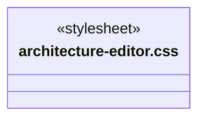

### ArchitectureEditor.tsx

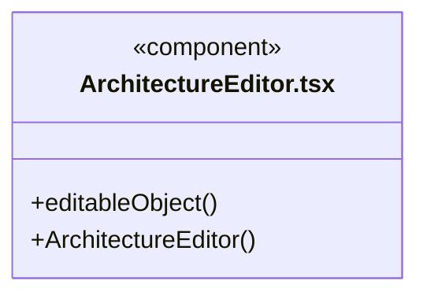

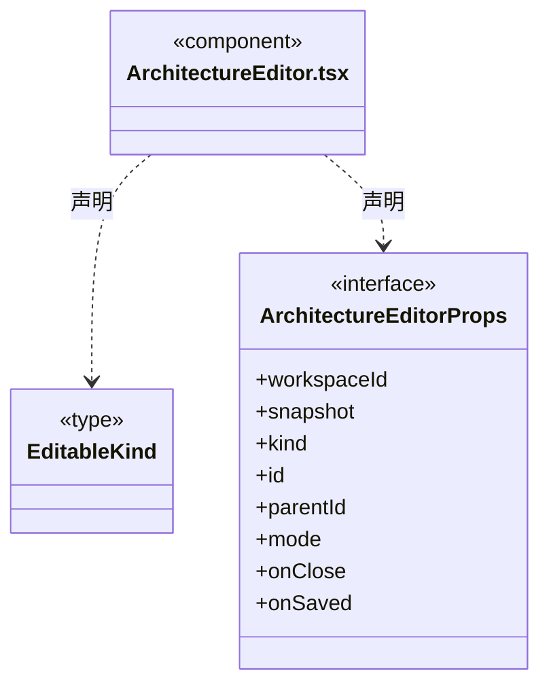

直接依赖：[../../bridge/contracts/ipc-call.ts](../../bridge/contracts/ipc-call.ts)、[../components/EngineModelPicker.tsx](../components/EngineModelPicker.tsx)、[../../bridge/contracts/engines.ts](../../bridge/contracts/engines.ts)、[../../bridge/contracts/models.ts](../../bridge/contracts/models.ts)、[../../bridge/contracts/agent-settings.ts](../../bridge/contracts/agent-settings.ts)、[../../bridge/contracts/workspace.ts](../../bridge/contracts/workspace.ts)、[../../bridge/contracts/architecture.ts](../../bridge/contracts/architecture.ts)、[static-owners.ts](static-owners.ts)、[architecture-editor.css](architecture-editor.css)。

### GovernanceLaunch.tsx

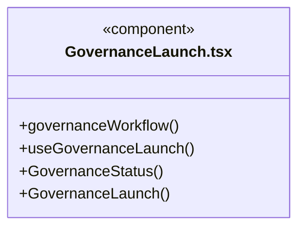

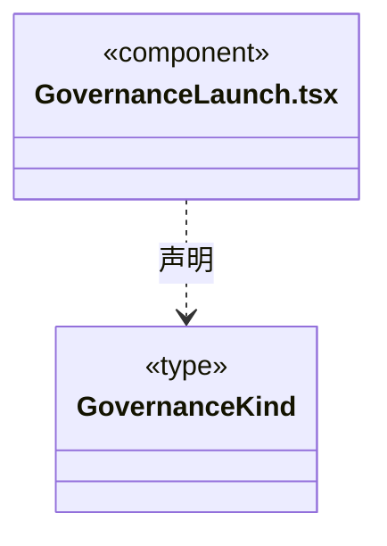

### knowledge-file-tree.ts

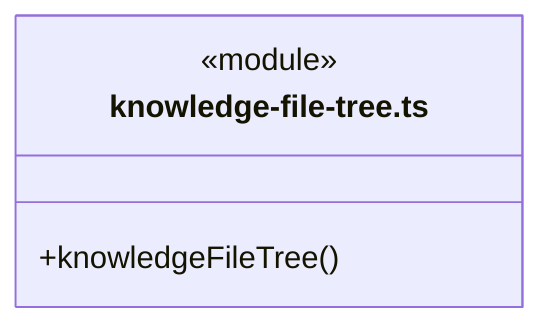

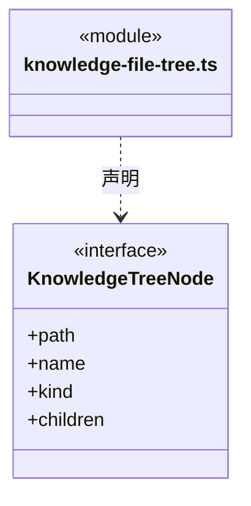

直接依赖：[../../bridge/contracts/workspace.ts](../../bridge/contracts/workspace.ts)。

### knowledge-files.css

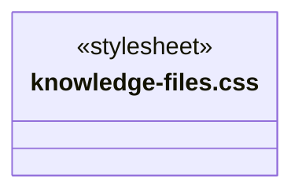

### knowledge-source.css

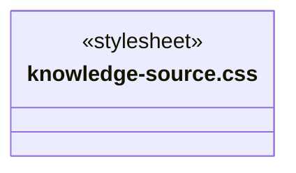

### KnowledgeFilePreview.tsx

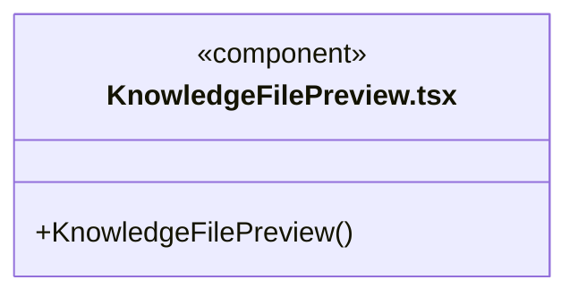

直接依赖：[../components/Icon.tsx](../components/Icon.tsx)、[../components/ModalFrame.tsx](../components/ModalFrame.tsx)、[../../bridge/contracts/workspace.ts](../../bridge/contracts/workspace.ts)、[../execution-view/MarkdownMessage.tsx](../execution-view/MarkdownMessage.tsx)、[knowledge-files.css](knowledge-files.css)。

### KnowledgeFileTree.tsx

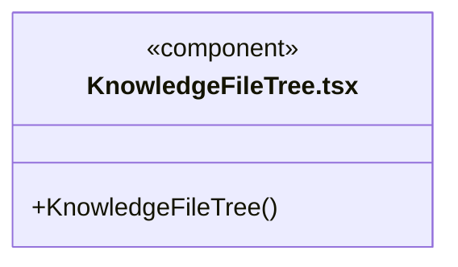

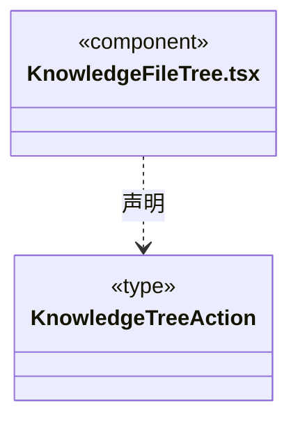

直接依赖：[../../bridge/contracts/workspace.ts](../../bridge/contracts/workspace.ts)、[../components/Icon.tsx](../components/Icon.tsx)、[knowledge-file-tree.ts](knowledge-file-tree.ts)、[knowledge-files.css](knowledge-files.css)、[../components/TreeActions.tsx](../components/TreeActions.tsx)。

### KnowledgeSourceDetails.tsx

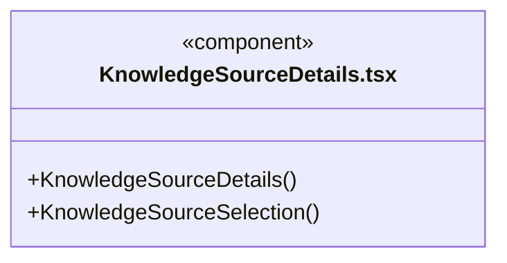

直接依赖：[../../bridge/contracts/knowledge-source.ts](../../bridge/contracts/knowledge-source.ts)、[knowledge-source.css](knowledge-source.css)。

### static-owners.ts

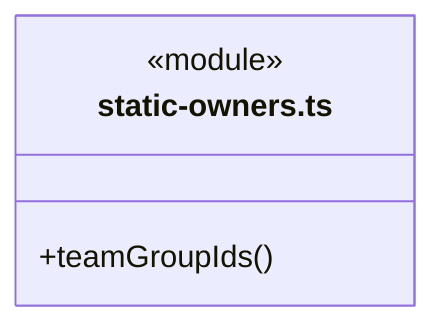

直接依赖：[../../bridge/contracts/workspace.ts](../../bridge/contracts/workspace.ts)。

### 本目录调用边界

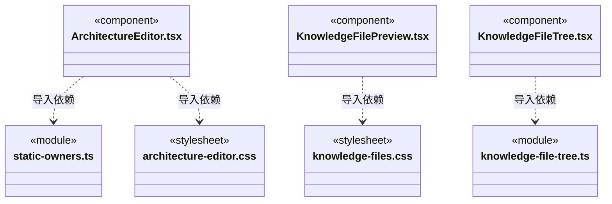

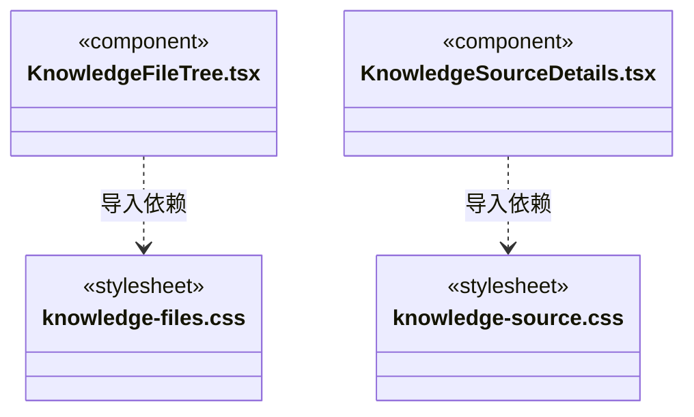

## 子目录导航

无子目录。

[返回上层](../ARCHITECTURE.md)。

每次修改本目录代码，同步维护文件头、关键契约说明及本图。未实现的治理、证据验收和自动编排能力不列入当前类图。

<!-- architecture:generated:end -->
