# src/view/knowledge 架构

## 目录定位

知识问题、预览提交、静态表单与共用来源说明。展示当前、退役、待采纳及待核实状态，不从路径或正文相同猜来源连续；来源组件无提交副作用。固定编辑基线，不要求真人维护声明，业务架构展示位于workspace。 Agent 编辑可保存本机默认引擎/模型，已有岗位不自动采纳。 动态架构表单先按对应IPC Schema核实；本地数据选择为封闭类别。

本文描述当前实现。通过分析目录边界后维护的 [源码架构脚本](../../../scripts/source-architecture.mjs) 同步清单和声明；代码变更时仍须核对职责、关键成员与关系。

## 代码清单

| 文件 | 当前职责 |
| --- | --- |
| [architecture-editor.css](architecture-editor.css) | 架构语义表单与导入/提交预览的共用布局。设计原因：在窄扩展区仍以独立对话框展示明确的变更边界，沿用应用主题与键盘表单。 */ |
| [ArchitectureEditor.tsx](ArchitectureEditor.tsx) | 团队与业务架构共用的语义对象编辑器，负责表单、删除影响预览和显式事务提交。 |
| [GovernanceLaunch.tsx](GovernanceLaunch.tsx) | 业务/团队架构的显式治理启动控制器及结果提示。 |
| [knowledge-file-tree.ts](knowledge-file-tree.ts) | 把快照中真实知识文件投影为相对目录树，供业务与团队界面共用。 |
| [knowledge-files.css](knowledge-files.css) | 对应界面的布局与视觉样式。 |
| [knowledge-source.css](knowledge-source.css) | 对应界面的布局与视觉样式。 |
| [KnowledgeFilePreview.tsx](KnowledgeFilePreview.tsx) | 在业务和团队架构中预览实际知识文件，并通过原知识事务编辑。 |
| [KnowledgeFileTree.tsx](KnowledgeFileTree.tsx) | 业务/团队共用的可展开知识目录与文件导航。 |
| [KnowledgeSourceDetails.tsx](KnowledgeSourceDetails.tsx) | 为项目岗位和模块责任共用展示来源身份、未决状态与明确采纳预览。 |
| [static-owners.ts](static-owners.ts) | 为静态架构编辑和资源导入提供可选的 Team/小组归属。 |

## 架构类图

### architecture-editor.css

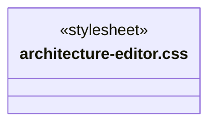

### ArchitectureEditor.tsx

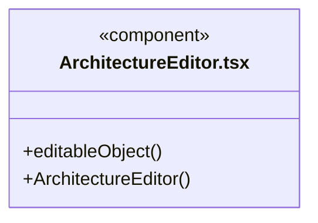

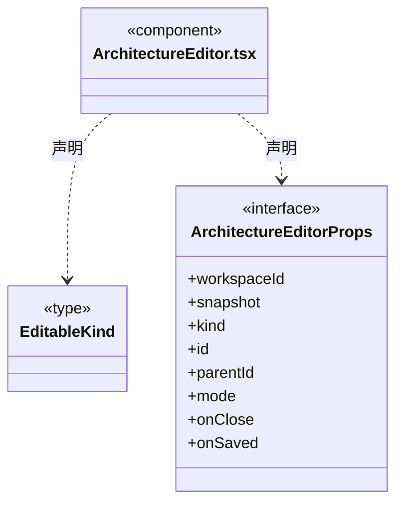

直接依赖：[../../bridge/contracts/ipc-call.ts](../../bridge/contracts/ipc-call.ts)、[../components/EngineModelPicker.tsx](../components/EngineModelPicker.tsx)、[../../bridge/contracts/engines.ts](../../bridge/contracts/engines.ts)、[../../bridge/contracts/models.ts](../../bridge/contracts/models.ts)、[../../bridge/contracts/agent-settings.ts](../../bridge/contracts/agent-settings.ts)、[../../bridge/contracts/workspace.ts](../../bridge/contracts/workspace.ts)、[../../bridge/contracts/architecture.ts](../../bridge/contracts/architecture.ts)、[static-owners.ts](static-owners.ts)、[architecture-editor.css](architecture-editor.css)。

### GovernanceLaunch.tsx

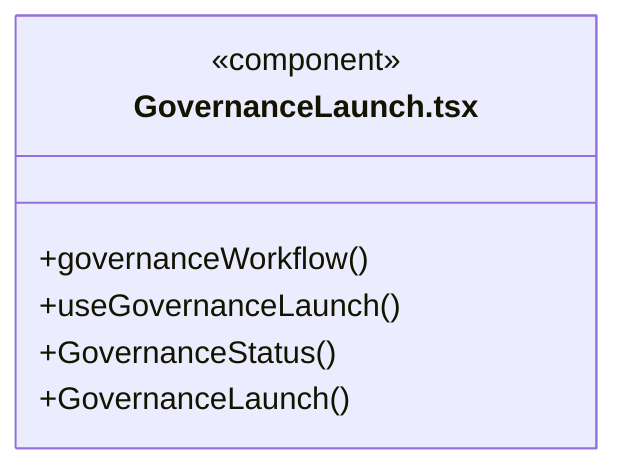

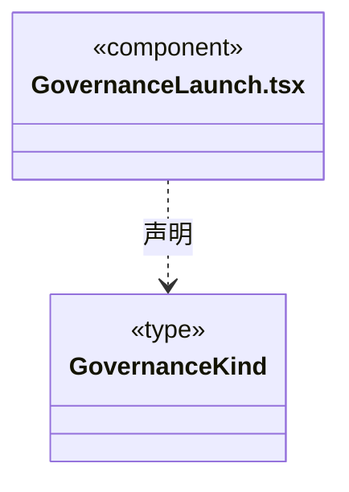

### knowledge-file-tree.ts

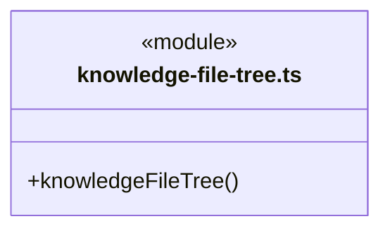

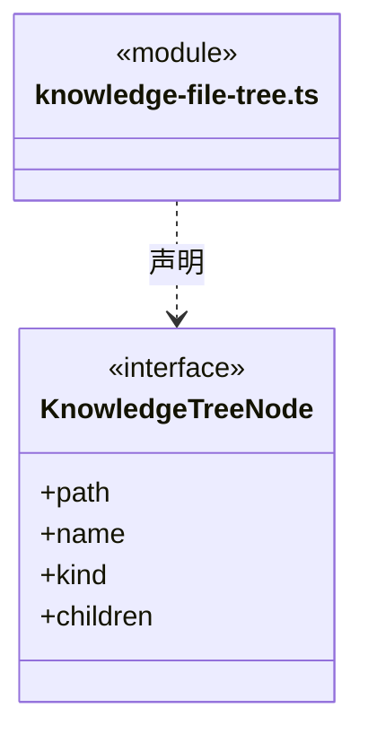

直接依赖：[../../bridge/contracts/workspace.ts](../../bridge/contracts/workspace.ts)。

### knowledge-files.css

### knowledge-source.css

### KnowledgeFilePreview.tsx

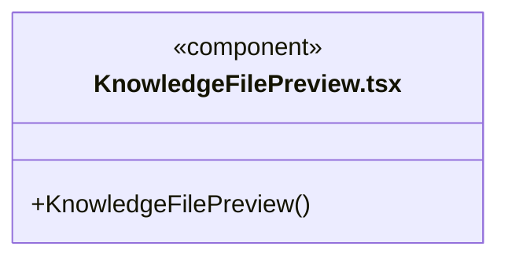

直接依赖：[../../bridge/contracts/workspace.ts](../../bridge/contracts/workspace.ts)、[../execution-view/MarkdownMessage.tsx](../execution-view/MarkdownMessage.tsx)、[knowledge-files.css](knowledge-files.css)。

### KnowledgeFileTree.tsx

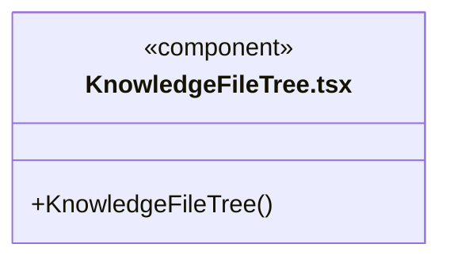

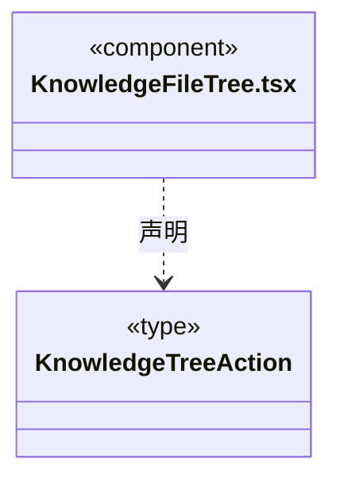

直接依赖：[../../bridge/contracts/workspace.ts](../../bridge/contracts/workspace.ts)、[../components/Icon.tsx](../components/Icon.tsx)、[knowledge-file-tree.ts](knowledge-file-tree.ts)、[knowledge-files.css](knowledge-files.css)、[../components/TreeActions.tsx](../components/TreeActions.tsx)。

### KnowledgeSourceDetails.tsx

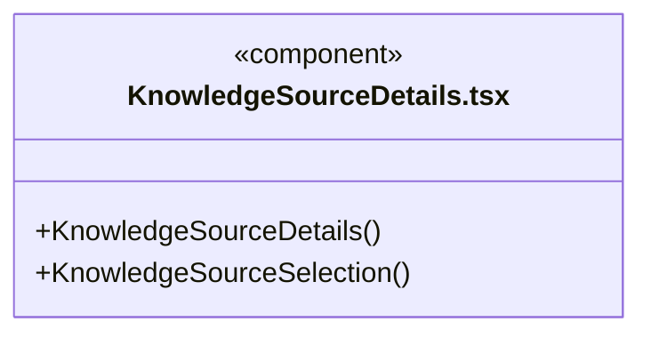

直接依赖：[../../bridge/contracts/knowledge-source.ts](../../bridge/contracts/knowledge-source.ts)、[knowledge-source.css](knowledge-source.css)。

### static-owners.ts

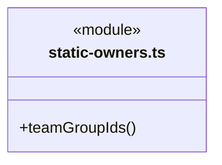

直接依赖：[../../bridge/contracts/workspace.ts](../../bridge/contracts/workspace.ts)。

### 本目录调用边界

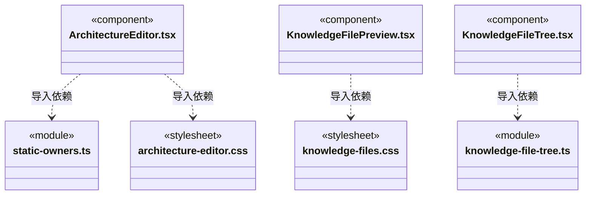

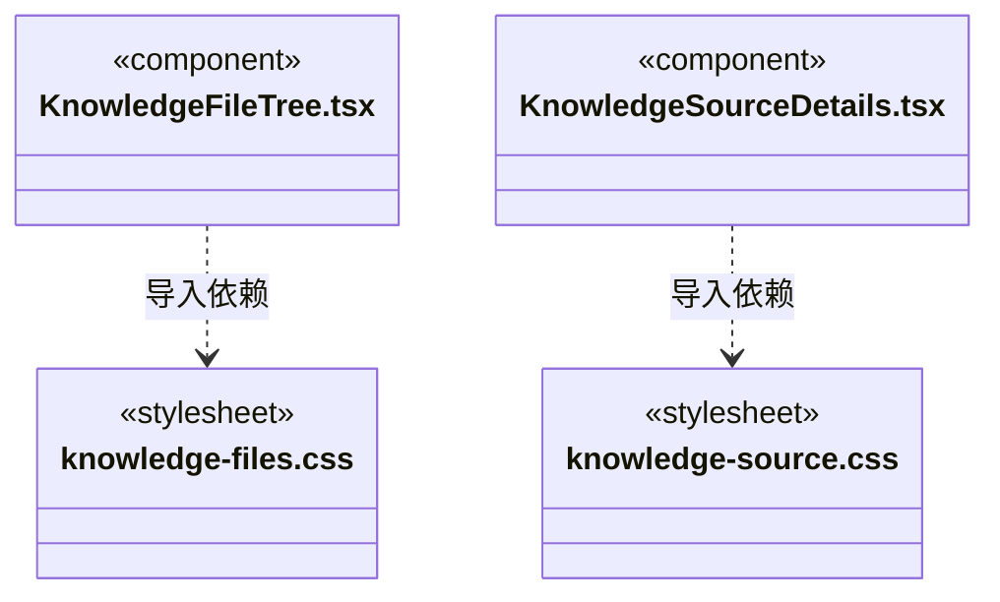

## 子目录导航

无子目录。

[返回上层](../ARCHITECTURE.md)。

每次修改本目录代码，同步维护文件头、关键契约说明及本图。未实现的治理、证据验收和自动编排能力不列入当前类图。

## 设计契约 v1 与落地范围

以下内容区分已接通能力与后续设计；以各节的实现状态为准，不将目标图当作现状图。维护源：[CONTRACT.md](CONTRACT.md)；生成类图时同步附加，勿直接修改本附录。

### 架构根菜单治理

useGovernanceLaunch 持有显式启动门禁；TreeActions 关闭不销毁它。结果独立展示，回执未知不自动重发，切换工作区隔离迟到响应。KnowledgeFileTree 的行菜单复用无业务状态的 TreeActions；团队与业务模块各有专门的语义导航。

### 单一树根与视图图标

每棵树只保留业务模块/团队架构一个根，展开和折叠全部在树右上角用图标显示，title和aria-label提供提示。操作仅更新本地closed集合；根的行尾菜单持续可用，搜索时仍展开匹配祖先，不把折叠当知识修改。

### 目录行尾操作

KnowledgeFileTree 的名称按钮后紧跟展开箭头，右侧竖向更多菜单只显示宿主为真实目录节点声明的动作。文件不自动得到模块/团队操作；回调捕获本行路径，不依赖右侧当前选中节点。图标操作保留 title 与 aria-label，Escape 关闭后回到菜单入口，点击外部关闭；树不查询/写知识或授予权限。选择、展开、菜单分开，320px长名称省略但路径可悬停查看。

# 静态架构编辑

`ArchitectureEditor` 从打开时的知识快照填入 Agent、Module、Skill 或 Workflow 表单。草稿固定 `workspaceId / instanceId / revision`；后台刷新不能改写正在编辑的字段。每次修改使旧预览失效，提交只发送后端返回的 `planId`。知识校验和事务边界由后端维护。

新增/编辑模块只维护静态定义和正文，不显示真人花名册或维护确认表单；岗位与负责人由独立入口配置。删除先展示引用和文件差异，含下级对象时要求明确选择级联；业务源码不在删除范围。

`static-owners` 从静态定义路径计算 Team 和分组候选，保留没有自己 Skill 清单的祖先组，排除 Agent 叶子。团队与业务定义是工作区共享知识，不读取或创建成员实例与主会话任务图。

## 来源身份展示

`KnowledgeSourceDetails` 共用展示岗位与模块责任的已采纳来源和当前核实状态：未追踪、已绑定、待采纳、退役、未决和不可核实分别呈现。旧记录缺省不从路径或内容指纹补造身份；内置执行者显示实际内容引用，不生成项目代次。资料只按文本呈现。

`KnowledgeSourceSelection` 在原提交预览中展示本次明确采纳的来源。未追踪对象在真正保存前不显示伪造 UUID；绑定来源不代表已按负责人派发或获得执行资格。两组件不查询、不提交，原界面命令控制器继续负责未知结果、原命令查询和工作区身份隔离。

ArchitectureEditor 的模块模板从 Bridge 的纯正文契约读取，与后端诊断保持同一标题及结构；模板不代填真实专业判断。

### Agent 默认选型

ArchitectureEditor 读取 models.list 提供引擎/模型选择，提交预览前核查仍可用。runtime 只用于新登记默认值，已有岗位独立配置；删除 Agent 不依赖其模型配置继续存在。

### Agent 引擎与模型

ArchitectureEditor 使用与主 Agent 相同的 AgentModelSelection 和 providerSupportsEngine，三引擎固定存在，模型来自统一启用目录。提交前按该模型的主接口、预设或自定义接口核实兼容性和型号范围；自定义 Agent 的能力与 runtime 仍一次知识事务提交。

## 共用文件树与编辑

KnowledgeFileTree 从当前工作区快照构建真实目录/文件树，折叠只影响查看。KnowledgeFilePreview 显示实际正文与快照格式诊断；编辑器固定打开版本，350ms 延迟完整事务预览，新输入立即作废旧预览，迟到响应丢弃，只有结构通过可提交。发送后的原请求锁定，未知结果不能换 ID 自动重发。派生 registry 只读。原高级 KnowledgeTools 页面已删除。

GovernanceLaunch 明确点击后通过 loop.chat 启动对应团队/业务架构治理工作流，使用主 Agent 保存选型和 ask 权限；真实 taskId 回交 Shell，未知启动不自动重试。
