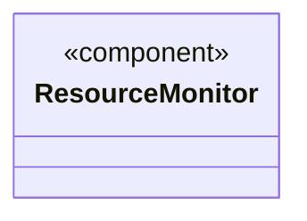

# 资源监视器

## 设计意图

独立渲染 Agent 和进程的资源占用。

## 主要组成

| 组成 | 定位 |
| --- | --- |
| [ResourceMonitor](ResourceMonitor.tsx) | 独立渲染 Agent 和进程的资源占用。 |

<!-- architecture:generated:start -->

## 架构关系

[上层设计](../ARCHITECTURE.md)

<!-- architecture:generated:end -->
