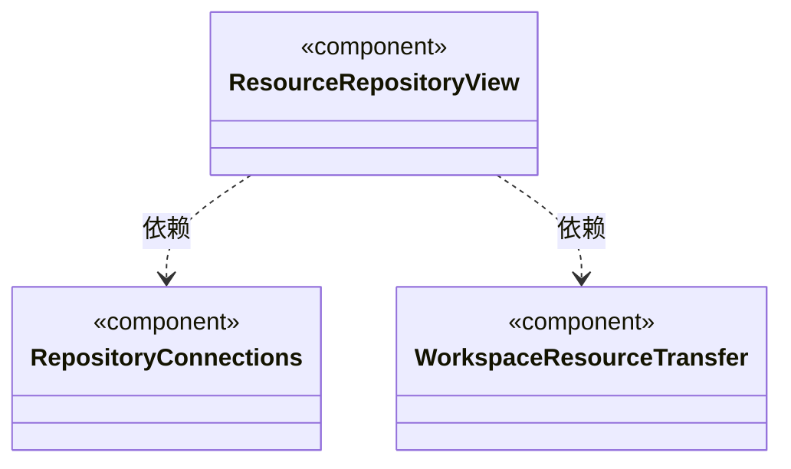

# src/view/resources 架构

## 设计意图

呈现资源仓库连接、静态包发布和下载应用。仓库查看、连接管理与工作区导入分别封装，共用预览和版本身份，不在页面实现仓库存储。

## 主要组成

| 组成 | 定位 |
| --- | --- |
| [ResourceRepositoryView](ResourceRepositoryView.tsx) | 三类资源共用的定义列表与编辑器；链接器页附带独立工作区仓库连接，人才包/完整业务架构有明确应用入口。 |
| [RepositoryConnections](RepositoryConnections.tsx) | 在链接器页按明确工作区登记仓库身份、独立授予主 Agent 只读连接并查看真实 HTTP 核验摘要。 |
| [WorkspaceResourceTransfer](WorkspaceResourceTransfer.tsx) | 静态团队能力与完整业务架构在当前工作区和共用仓库之间的发布、下载及应用界面。 |

<!-- architecture:generated:start -->

## 架构关系

[上层设计](../ARCHITECTURE.md)

<!-- architecture:generated:end -->
