# src/view/resources 架构

## 目录定位

统一资源仓库的查看、编辑、静态包发布与下载应用。人才按团队/Agent/Skill复用，业务按整套架构应用；工作区身份及预览版本固定。设置通过统一入口打开。 连接操作名使用持久命令的动作联合，提交、未知与核实流程保持。 连接提交与回执查询按具体Schema形成操作元组。

本文描述当前实现。通过分析目录边界后维护的 [源码架构脚本](../../../scripts/source-architecture.mjs) 同步清单和声明；代码变更时仍须核对职责、关键成员与关系。

## 代码清单

| 文件 | 当前职责 |
| --- | --- |
| [repository-connection-state.ts](repository-connection-state.ts) | 资源仓库连接写请求的本地待确认记录与严格回执匹配，供链接器界面跨卸载、重开核对原请求。 |
| [repository-connections.css](repository-connections.css) | 对应界面的布局与视觉样式。 |
| [RepositoryConnections.tsx](RepositoryConnections.tsx) | 在链接器页按明确工作区登记仓库身份、独立授予主 Agent 只读连接并查看真实 HTTP 核验摘要。 |
| [resource-application.ts](resource-application.ts) | 资源列表的静态包识别与可创建种类策略，供列表和测试复用。 |
| [ResourceRepositoryView.tsx](ResourceRepositoryView.tsx) | 三类资源共用的定义列表与编辑器；链接器页附带独立工作区仓库连接，人才包/完整业务架构有明确应用入口。 |
| [workspace-transfer.css](workspace-transfer.css) | 静态资源发布/导入的选择列表与回执。设计原因：共享库来源、应用目标和整包替换在窄屏上仍可明确辨认。 */ |
| [WorkspaceResourceTransfer.tsx](WorkspaceResourceTransfer.tsx) | 静态团队能力与完整业务架构在当前工作区和共用仓库之间的发布、下载及应用界面。 |

## 架构类图

### repository-connection-state.ts

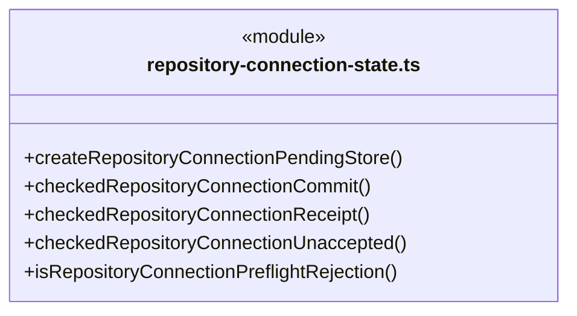

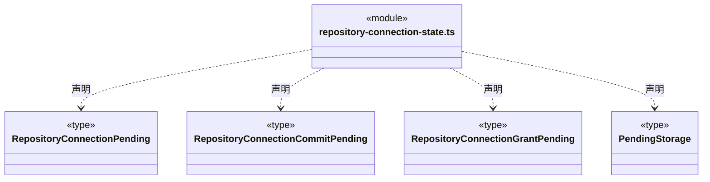

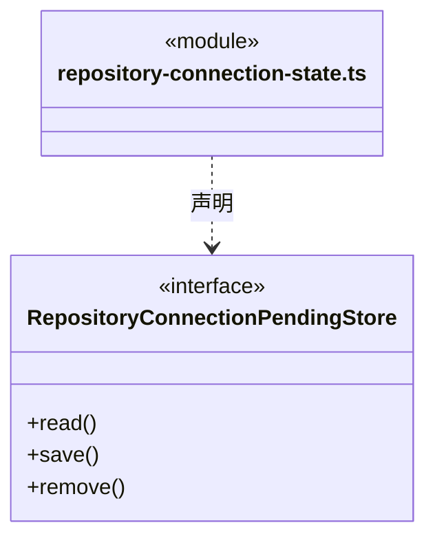

直接依赖：[../../bridge/contracts/repository-connections.ts](../../bridge/contracts/repository-connections.ts)。

### repository-connections.css

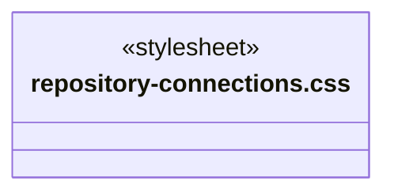

### RepositoryConnections.tsx

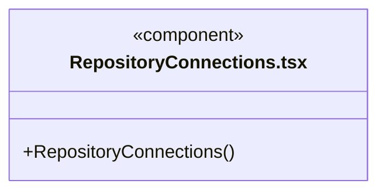

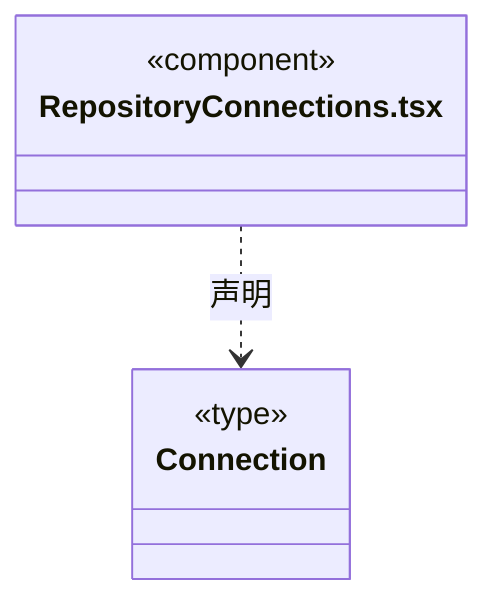

直接依赖：[../../bridge/contracts/ipc-call.ts](../../bridge/contracts/ipc-call.ts)、[../../bridge/contracts/workspace.ts](../../bridge/contracts/workspace.ts)、[../../bridge/contracts/resources.ts](../../bridge/contracts/resources.ts)、[../../bridge/contracts/repository-connections.ts](../../bridge/contracts/repository-connections.ts)、[repository-connection-state.ts](repository-connection-state.ts)、[repository-connections.css](repository-connections.css)。

### resource-application.ts

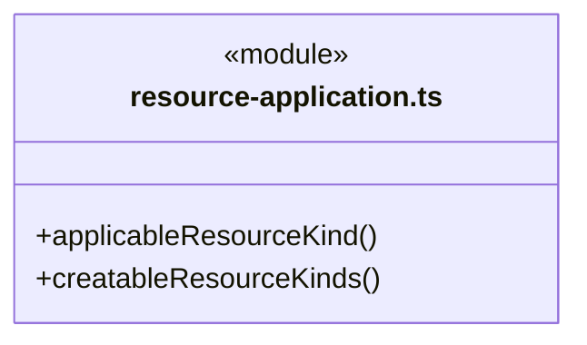

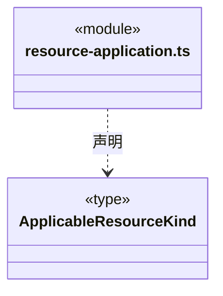

直接依赖：[../../bridge/contracts/resources.ts](../../bridge/contracts/resources.ts)。

### ResourceRepositoryView.tsx

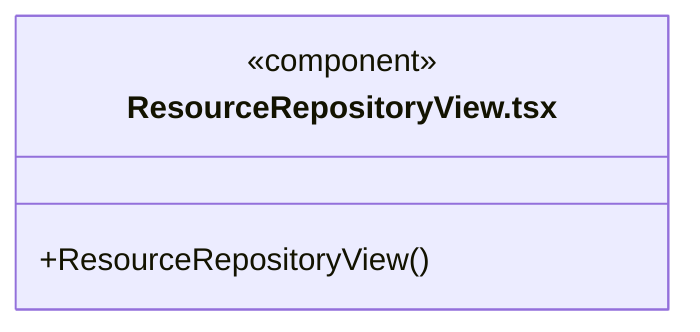

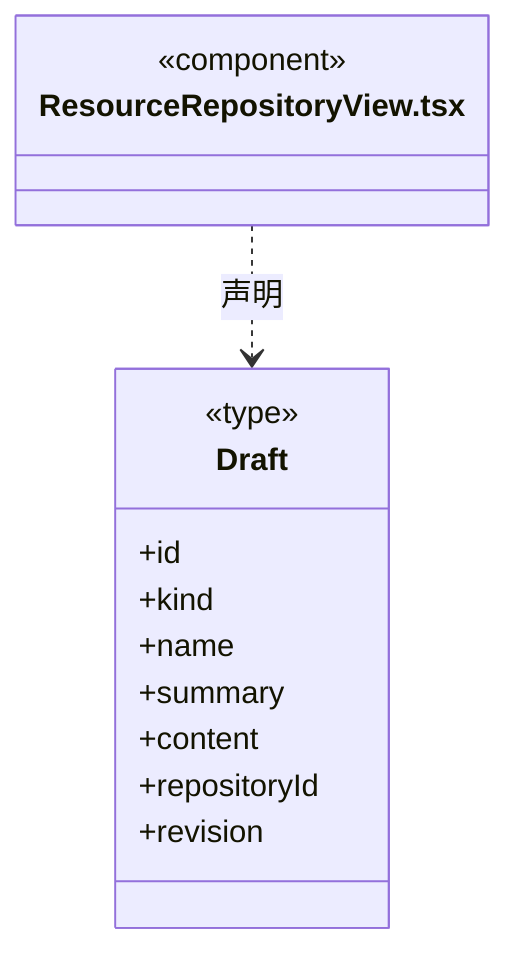

直接依赖：[../../bridge/contracts/resources.ts](../../bridge/contracts/resources.ts)、[../../bridge/contracts/workspace.ts](../../bridge/contracts/workspace.ts)、[WorkspaceResourceTransfer.tsx](WorkspaceResourceTransfer.tsx)、[RepositoryConnections.tsx](RepositoryConnections.tsx)、[resource-application.ts](resource-application.ts)。

### workspace-transfer.css

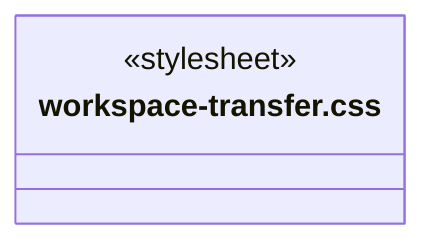

### WorkspaceResourceTransfer.tsx

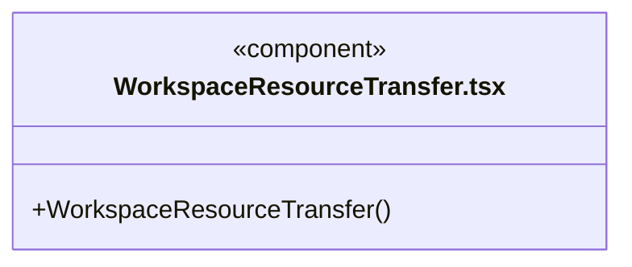

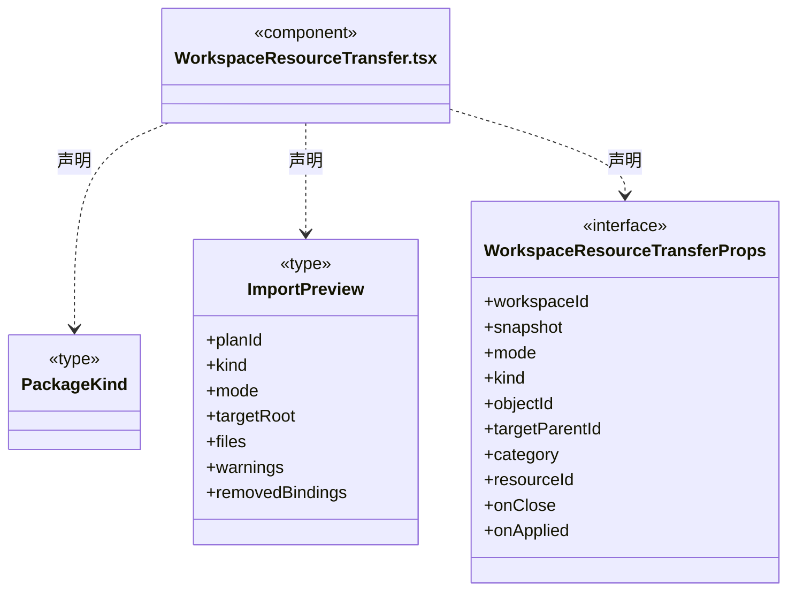

直接依赖：[../../bridge/contracts/workspace.ts](../../bridge/contracts/workspace.ts)、[../../bridge/contracts/resources.ts](../../bridge/contracts/resources.ts)、[../knowledge/static-owners.ts](../knowledge/static-owners.ts)、[resource-application.ts](resource-application.ts)、[../knowledge/architecture-editor.css](../knowledge/architecture-editor.css)、[workspace-transfer.css](workspace-transfer.css)。

### 本目录调用边界

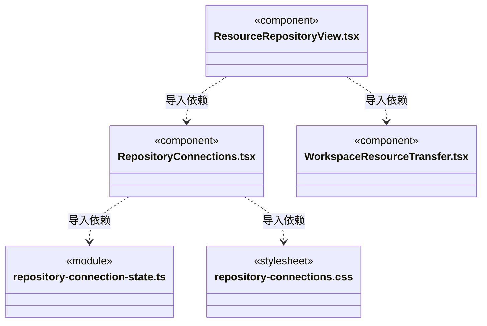

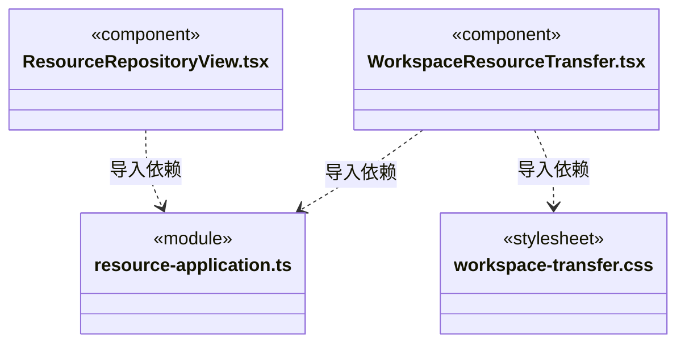

## 子目录导航

无子目录。

[返回上层](../ARCHITECTURE.md)。

每次修改本目录代码，同步维护文件头、关键契约说明及本图。未实现的治理、证据验收和自动编排能力不列入当前类图。

## 设计契约 v1 与落地范围

以下内容区分已接通能力与后续设计；以各节的实现状态为准，不将目标图当作现状图。维护源：[CONTRACT.md](CONTRACT.md)；生成类图时同步附加，勿直接修改本附录。

# 资源仓库界面契约

## 工作区资源仓库连接

`RepositoryConnections` 仅出现在链接器页。用户明确选择已就绪工作区，先预览并登记当前已共享仓库的静态定义，再独立点击允许只读连接。两步回执分别显示，不把知识提交视为授权，也不自动开启服务或让静态文本资源执行。

列表和核验由显式操作读取，不轮询全部资源。核验展示真实 HTTP 的有界摘要、版本和时间，不展示正文、URL 或令牌；已显示摘要只是当次观察，不承诺持续在线。关闭共享或撤销后重新核验必须由后端拒绝，界面不降级读本地文件。

请求冻结目标身份、知识/授权版本；同步锁阻止双击，目标代际丢弃迟到响应。`repository-connection-state.ts` 先在本机同步保存小体积冻结请求，最多 64 个工作区、256 KiB，不含完整预览、正文或密钥；存储失败不发送，损坏数据不覆盖。严格匹配原计划/命令与完整身份、定义哈希和授权下一版本，迟到回执不能清除后来请求。

授权或登记结果未知时保留原命令/计划，只查原回执或重试原请求，不新建写操作。首次明确预提交拒绝可以解除；曾未知或重开恢复后不能用后来错误推断未发生。页面重入只恢复本地记录并读取当前状态，不重放操作。实例已更换时只查原回执；另一个显式“核实未受理并解除”操作必须取得服务关于旧实例退役且无原事务/命令的肯定证明，查不到回执本身不足以清记录。

授权页面明确说明资料可进入本工作区所选模型的上下文。主 Agent 每轮只装配已授权的目录与资料工具，固定原连接；撤销或换代后不能继续沿旧目标读取或交付迟到结果。该提示不代表自动安装资料，桌面核验也不启动模型。CSS 按现有主题变量排版，窄窗口换行；资源标识不撑宽页面。

## 静态资源发布与应用

- 链接器、人才市场和业务模板共用同一个当前仓库；资源保存不等于应用到项目或授予执行权限。
- 全局列表只为 `format: cbim-workspace-package` 且包类型与资源条目一致的 team、agent、skill、architecture 显示“应用到工作区”。这只是界面识别，格式、指纹、正文引用和目标知识仍由后端预览校验。
- 选择应用目标时读取工作区登记清单，只允许当前已就绪的工作区。继续时取得该目标的 `Snapshot`，核对 `workspaceId` 后交给 `WorkspaceResourceTransfer`。不使用主界面当前选择隐式定位目标，也不自动打开工作区或启动 Agent。
- `WorkspaceResourceTransfer` 固定目标知识版本和资源仓库版本，先预览再由用户明确提交；整包替换必须显式选择。导入成功保留结果、移除绑定和警告说明。源项目人员、工具绑定、授权、实例、任务及会话均不作为复用资源导入。
- 人才可整体发布 Team、单独发布 Agent 或 Skill；业务模板只整体应用完整 architecture。旧 module/workflow 资源可浏览编辑和删除，不能新增、复制或直接应用单一模块/流程；已有纯文本资源也不自动转换为知识包。
- `resource-application.ts` 为纯展示策略，不能作为后端校验或权限依据。列表不会把某个资源标记为“从未应用”：同一静态包可以在多个项目被独立使用。
- 页面切换或卸载使进行中的目标选择读取失效，迟到响应不能打开另一页面的应用弹窗。对目标的知识写入仅来自随后共享弹窗的显式提交。
- 资源包正文在仓库文本编辑器中只读，仍可编辑展示名称/说明。需要定制内容时先应用到工作区，经语义编辑后重新发布，避免直接改 JSON 破坏指纹和引用关系。自由文本编辑上限与仓库的 2 Mi 字符保持一致。

### 导入后的责任配置

WorkspaceResourceTransfer 不再要求登记真人维护人；整套业务导入后按需配置岗位负责人及源目录。替换 Team 的旧人员文件保留但不影响有效性，实际覆盖范围仍由受控预览展示。

仓库连接提交从原待确认请求的 commit/grant/revoke 联合构造固定 IPC 动作；保存前态、首次明确拒绝和未知结果核实保持。
