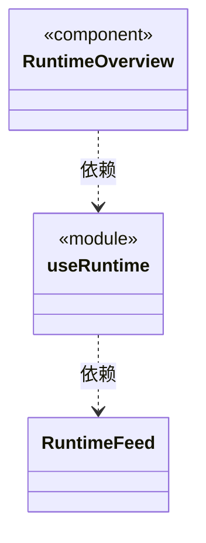

# src/view/runtime 架构

## 设计意图

提供跨工作区的只读运行总览，分别展示周期、人员、任务、占用与已报告消耗。

`RuntimeFeed` 保存窗口共享游标和已确认快照，React 适配按可见性订阅，页面和行组件消费相同投影。导航指向已有会话，不创建任务或恢复运行；未变化行和未知用量保持原语义。

## 主要组成

| 组成 | 定位 |
| --- | --- |
| [RuntimeFeed](runtime-feed.ts) | 维护窗口内只读监管游标、最近确认快照和增量发布，供运行管理页面订阅。 |
| [RuntimeOverview](RuntimeOverview.tsx) | 组合周期、人员、任务、准入及消耗的只读总览。 |
| [useRuntime](useRuntime.ts) | 将共享 feed 接入 React，并按文档可见性暂停读取。 |

<!-- architecture:generated:start -->

## 架构关系

[上层设计](../ARCHITECTURE.md)

<!-- architecture:generated:end -->
