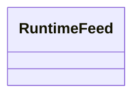

# src/view/runtime 架构

## 设计意图

全局只读运行管理。分别呈现目标周期、人员、任务、准入等待和已报告消耗；单次在途游标读取保留未变行，隐藏时退订，按真实身份定位既有会话而不执行任务。

## 主要组成

| 组成 | 定位 |
| --- | --- |
| [RuntimeFeed](runtime-feed.ts) | 维护窗口内只读监管游标、最近确认快照和增量发布，供运行管理页面订阅。 |

<!-- architecture:generated:start -->

## 架构关系

[上层设计](../ARCHITECTURE.md)

<!-- architecture:generated:end -->
