# src/view/runtime 架构

本目录只维护这一份说明。设计与契约直接编辑本文；文件清单、类图和导航由 [架构脚本](../../../scripts/source-architecture.mjs) 更新，生成区域之外的人工说明会保留。

## 封装意图

全局只读运行管理。分别呈现目标周期、人员、任务、准入等待和已报告消耗；单次在途游标读取保留未变行，隐藏时退订，按真实身份定位既有会话而不执行任务。

## 类与模块的设计意图

下表依据源码声明及文件头说明定位封装。字段表示该实例持有的状态或协作引用，不表示它拥有被引用服务的生命周期；实际资源责任和调用限制见下文契约及源码注释。

| 类／模块 | 实现形式与实例字段 | 封装依据 |
| --- | --- | --- |
| [RuntimeFeed](runtime-feed.ts) | 实例类；持有 `value`、`listeners`、`timer`、`generation`、`pending`、`read`、`intervalMs` | 一份页面事实流；transport 校验失败保留旧数据并明确过期，不解释成零负载。 |
| [runtime-view-state.ts](runtime-view-state.ts) | 函数／契约模块 | 模型轮次、调度周期和成员任务具有不同终态；统一展示词汇但不合并状态，更不从角色名或时间猜测会话身份。 |
| [RuntimeOverview.tsx](RuntimeOverview.tsx) | 组件模块 | 应用统计和列表筛选分开，缺失计量不冒充零；原会话操作交由外壳按真实身份核实。 |
| [RuntimeRows.tsx](RuntimeRows.tsx) | 组件模块 | memo 配合未变行引用避免流式状态刷新重建整表；打开原会话只传可信标识，不创建执行请求。 |
| [useRuntime.ts](useRuntime.ts) | 函数／契约模块 | 外壳离开运行管理会卸载本订阅；窗口最小化/隐藏时也不持续轮询，恢复可见后按原游标补读。 |

## 接口设计契约

### 全局运行总览

任务/运行行增加与文字并列的 stateIconNames，completed 使用 history；刷新与原会话定位使用公共 Icon。卡片、筛选和压力指标统一主题及字号，不改变只读数据口径或定位契约。

只消费 runtime.read 与现有独立 admission.read，不启动或恢复模型。监管的 scope、派发 task、模型 run、成员与用户消息队列分别展示；模型轮次 completed 标为“本轮结束”，closed/completed 但没有完成审阅仅表示周期结束；实际完成审阅和周期结算同时存在才显示“目标周期完成”。这些系统事实仍不代表人工业务验收。

RuntimeFeed 持有窗口唯一在途读取与独立游标，noop 保持快照引用，变化快照重用未变行；同游标矛盾内容拒绝，错误保留旧值并明确可能过期，关闭/隐藏页面停止订阅与计时。新进程 stream 换入新快照，退订代际屏蔽迟到结果。没有轮询全部日志或正文。

统计始终为全局观察值；筛选仅作用下方列表。已报告消耗、价格缺失、未报告运行与不完整来源各自表达，不把缺失变成免费或零压力。准入与监管来自各自游标，不承诺跨快照原子一致。

原会话定位只传真实 workspaceId/rootSessionId，可附 scopeId/taskId；Shell 和 Conversation 核验既有绑定后定位，不按角色或最近运行猜测身份，不修改权限、任务或知识。独立运行的旧无绑定记录不提供伪造跳转。

派发列表与缓存键包含 workspace/root/task，逐运行键包含 workspace/task/run；不能因历史标识重名复用另一会话的行。

##### 运行监管订阅边界

RuntimeFeed 的 listeners 使用前端 SubscriptionSet，通知保持同步实时遍历、按身份去重和异常原样传播。首订阅触发 refresh、末退订停止计时、generation 隔离迟到结果以及 pending 合并读取仍由 RuntimeFeed 负责。集合清空或退订不代表后端请求已取消。

##### 异步结果失效边界

RuntimeFeed 组合前端 AsyncGeneration；首订阅和末退订推进代次，refresh 只捕获当前标记。旧结果丢弃，pending 仍按 Promise 身份清理；当前仍有订阅时，旧代完成立即安排补读，新代完成按原间隔轮询。响应校验顺序、游标和行引用规则保持，代次推进不取消后端读取。

#### 监管记录分类

RuntimeOverview 用目标与任务、成员实例、运行与用量、项目与队列四组面板组织同一只读快照。隐藏面板保持挂载以保留展开量；工作区与状态筛选共享且可清除，上方统计仍为全局。准入等待继续明确为独立快照，不与已启动运行混合。

#### 单人工具范围

运行管理展示本地 Agent 实例的执行活动，不是人员在线状态。任务交接、阻塞与未知回执仍由原任务流程处理；不提供多人邀请、账号协作或人员消息入口。

#### 统一排版（2026-11-16）

普通文字、按钮、状态和说明复用 components/interface.css 的 --font-ui 与 --weight-regular；结构短标题使用 --weight-medium。颜色和间距承担次要信息层级，不把说明文字缩小。代码使用 --font-code，真实 Markdown 标题保留语义层级。

## 开闭边界

本目录的职责及允许协作由[封装意图](#封装意图)限定，输入输出、状态与失败语义以[接口设计契约](#接口设计契约)为准。扩展从已有公开入口及实际装配位置进入；没有明确可替换契约的部分按真实影响修改和验证，不预建未使用的基类或插件入口。

<!-- architecture:generated:start -->

## 文件清单

| 文件 | 形式 | 当前职责 |
| --- | --- | --- |
| [ARCHITECTURE.md](ARCHITECTURE.md) | 说明文档 | 本目录的文件清单、真实声明、依赖与子封装导航。 |
| [RuntimeOverview.tsx](RuntimeOverview.tsx) | 组件模块 | 全局只读运行总览，集中显示周期、Agent 实例、任务、准入等待及已报告消耗。 |
| [RuntimeRows.tsx](RuntimeRows.tsx) | 组件模块 | 全局监管中的独立只读行，分别呈现周期、任务、成员和运行，不混淆各自终态。 |
| [runtime-feed.ts](runtime-feed.ts) | 源码模块 | 维护窗口内只读监管游标、最近确认快照和增量发布，供运行管理页面订阅。 |
| [runtime-overview.css](runtime-overview.css) | 样式 | 只读全局监管的自适应列表与统计。设计原因：沿用主题变量并在窄屏换行，身份长串不挤压原会话操作。 */ |
| [runtime-view-state.ts](runtime-view-state.ts) | 源码模块 | 全局运行页面的纯筛选、状态说明与原会话定位契约。 |
| [useRuntime.ts](useRuntime.ts) | 源码模块 | 把窗口共享的监管快照接入 React，并跟随文档可见性暂停后台读取。 |

## 架构类图

成员标记：`+` 公开、`-` 私有、`#` 受保护、`$` 静态；`function` 为函数值成员，`get`／`set` 为访问器。调用／构造／索引签名按匿名签名列出，不虚构方法名；`global.` 表示全局声明补充，非运行时嵌套类。构造函数单独列出，运行时私有字段保留 `#`。文档和资源仅在文件清单中导航，不作为代码节点。

### runtime-feed.ts

[查看源码](runtime-feed.ts)。

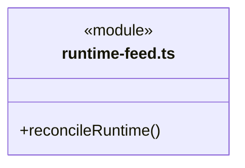

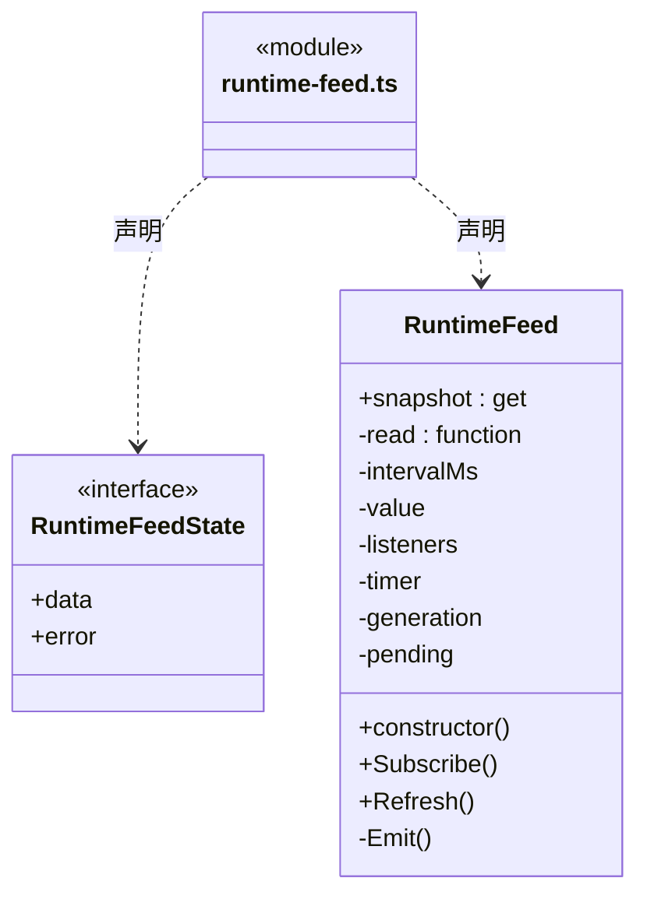

直接依赖：[../../bridge/contracts/runtime.ts](../../bridge/contracts/runtime.ts)、[../foundations/utility/index.ts](../foundations/utility/index.ts)、[runtime-view-state.ts](runtime-view-state.ts)。

### runtime-overview.css

[查看源码](runtime-overview.css)。

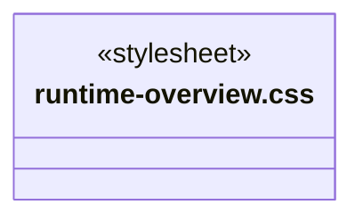

### runtime-view-state.ts

[查看源码](runtime-view-state.ts)。

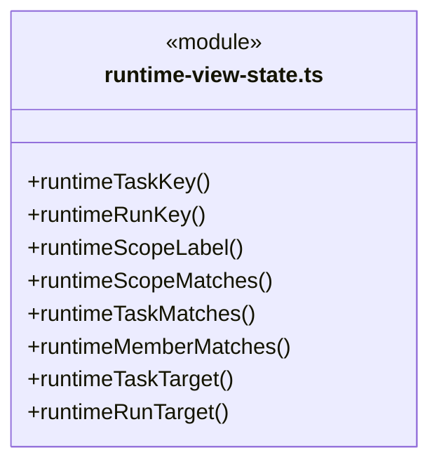

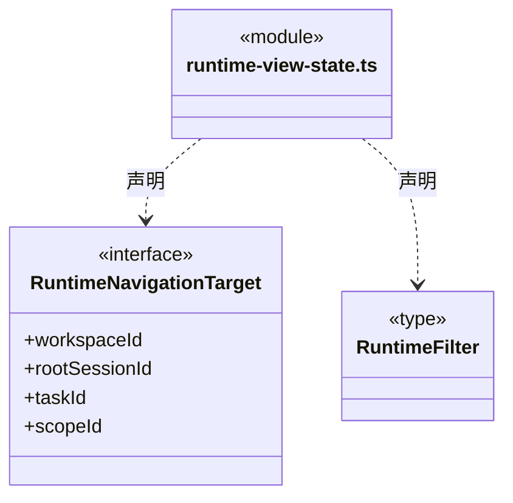

直接依赖：[../../bridge/contracts/runtime.ts](../../bridge/contracts/runtime.ts)。

### RuntimeOverview.tsx

[查看源码](RuntimeOverview.tsx)。

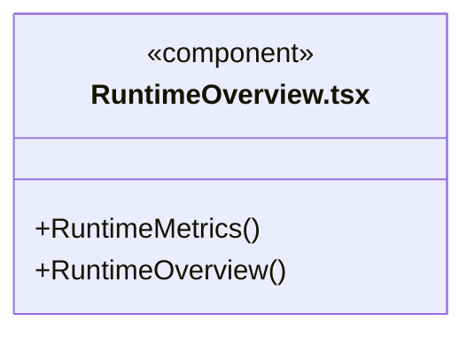

直接依赖：[../../bridge/contracts/runtime.ts](../../bridge/contracts/runtime.ts)、[../../bridge/contracts/usage.ts](../../bridge/contracts/usage.ts)、[../components/Icon.tsx](../components/Icon.tsx)、[../components/ViewTabs.tsx](../components/ViewTabs.tsx)、[RuntimeRows.tsx](RuntimeRows.tsx)、[runtime-overview.css](runtime-overview.css)、[runtime-view-state.ts](runtime-view-state.ts)、[useRuntime.ts](useRuntime.ts)、[../tasks/useAdmission.ts](../tasks/useAdmission.ts)。

### RuntimeRows.tsx

[查看源码](RuntimeRows.tsx)。

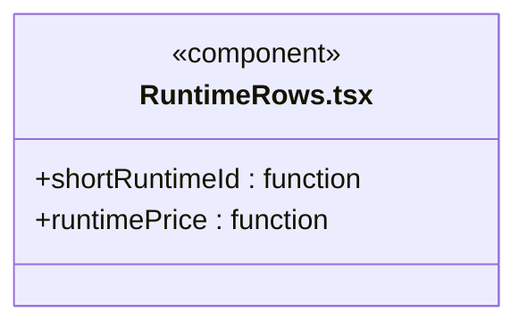

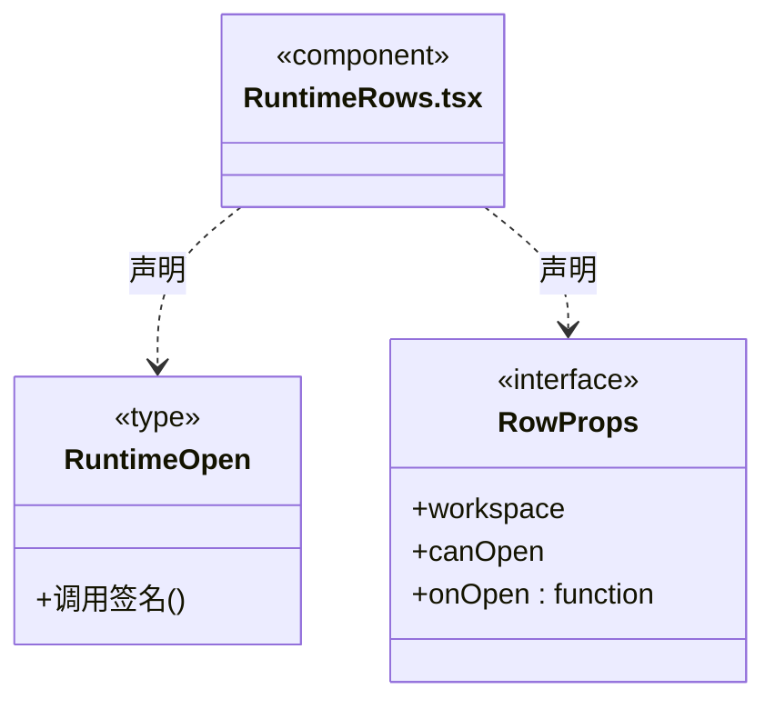

匿名签名（RuntimeOpen，不是具名方法）：`(target: RuntimeNavigationTarget) => void`。
直接依赖：[../../bridge/contracts/admission.ts](../../bridge/contracts/admission.ts)、[../../bridge/contracts/runtime.ts](../../bridge/contracts/runtime.ts)、[../../bridge/contracts/usage.ts](../../bridge/contracts/usage.ts)、[../components/Icon.tsx](../components/Icon.tsx)、[../components/state-labels.ts](../components/state-labels.ts)、[runtime-view-state.ts](runtime-view-state.ts)。

### useRuntime.ts

[查看源码](useRuntime.ts)。

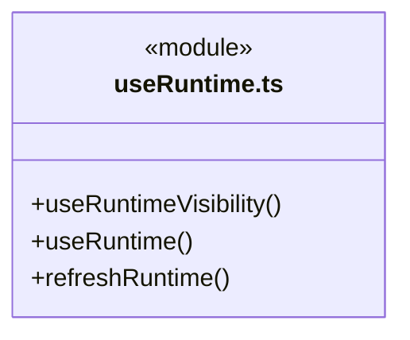

直接依赖：[runtime-feed.ts](runtime-feed.ts)。

### 本目录调用边界

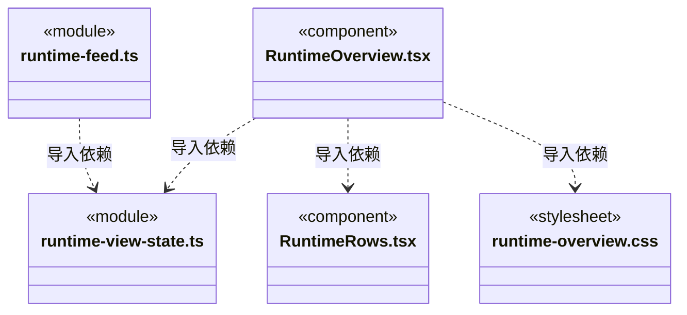

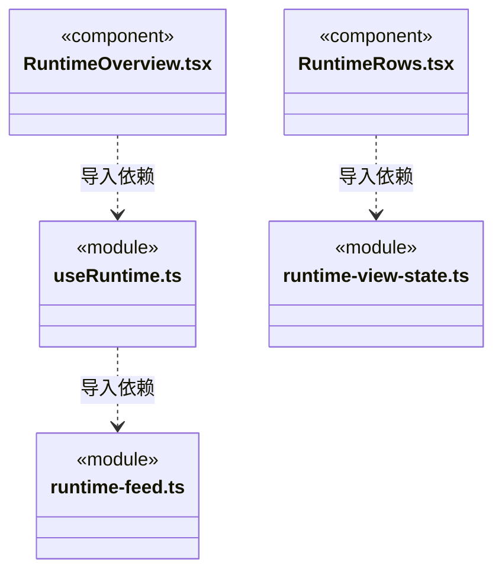

## 子目录导航

无子目录。

[返回上层](../ARCHITECTURE.md)。

每次修改本目录代码，同步维护文件头、关键契约说明及本图。未实现的治理、证据验收和自动编排能力不列入当前类图。

<!-- architecture:generated:end -->
