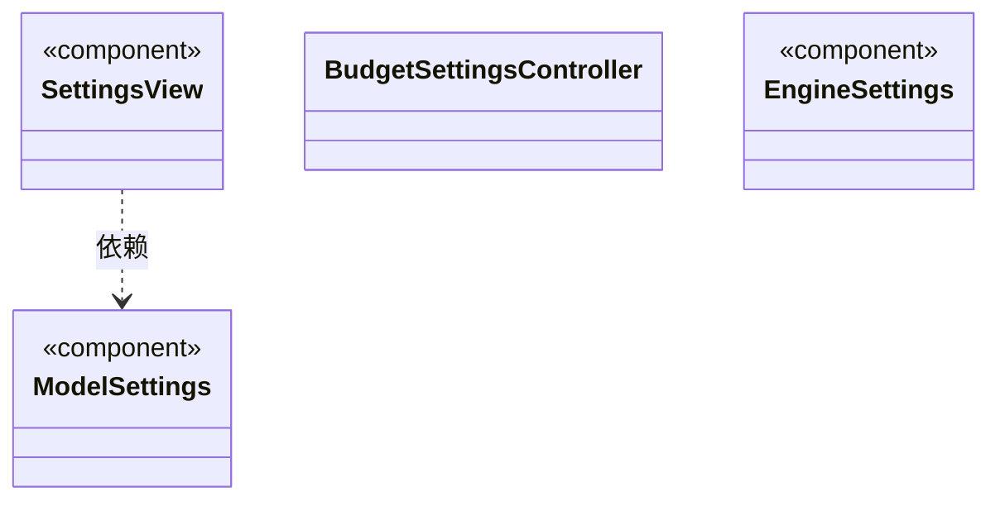

# src/view/settings 架构

## 设计意图

将应用设置组织为可导航的独立表单，使各领域继续通过自己的版本和保存入口管理配置。

`SettingsView` 负责分类与搜索，模型、引擎、预算、网页等表单调用原业务契约；`BudgetSettingsController` 隔离草稿和迟到响应。外观由 shell 的唯一控制器提供，保存默认值不追改活动运行的冻结配置。

## 主要组成

| 组成 | 定位 |
| --- | --- |
| [BudgetSettingsController](budget-settings-state.ts) | 管理额度及显式逐请求模式草稿、版本化保存，隔离页面卸载后的异步响应；缺省仍是运行间软限额。 |
| [SettingsView](SettingsView.tsx) | 设置中心的分类导航、搜索与独立子页面；业务表单仍通过原 IPC 保存。 |
| [ModelSettings](ModelSettings.tsx) | 编辑供应商、协议连接与模型目录，通过模型服务保存。 |
| [EngineSettings](EngineSettings.tsx) | 组织已安装引擎总览及单引擎能力、模型和包状态。 |

<!-- architecture:generated:start -->

## 架构关系

[上层设计](../ARCHITECTURE.md)

<!-- architecture:generated:end -->
