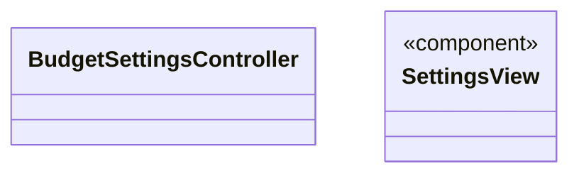

# src/view/settings 架构

## 设计意图

组织应用设置的分类导航、搜索与独立表单。各表单通过原业务契约读写配置，预算控制器维护编辑状态；外观偏好和应用布局由 shell 持有。

## 主要组成

| 组成 | 定位 |
| --- | --- |
| [BudgetSettingsController](budget-settings-state.ts) | 管理额度及显式逐请求模式草稿、版本化保存，隔离页面卸载后的异步响应；缺省仍是运行间软限额。 |
| [SettingsView](SettingsView.tsx) | 设置中心的分类导航、搜索与独立子页面；业务表单仍通过原 IPC 保存。 |

<!-- architecture:generated:start -->

## 架构关系

[上层设计](../ARCHITECTURE.md)

<!-- architecture:generated:end -->
