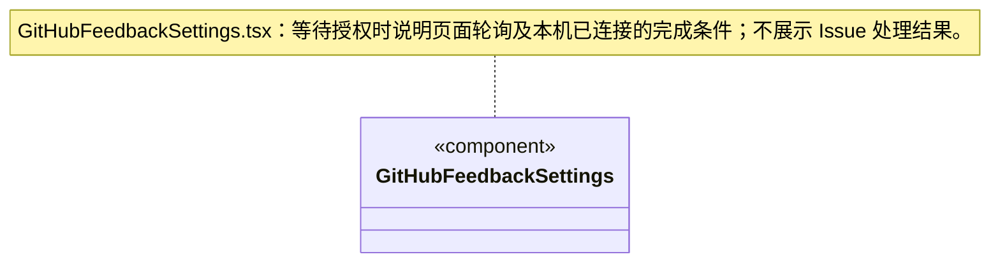

### 网页与搜索

WebSettings 显示浏览器 robots 策略（默认允许读正文、可选遵守规则）、Brave Search API 开关与密码输入；明确查询词发送给供应商。策略不依赖搜索密钥，可在安全存储不可用时保存。保存成功清空密钥输入，移除密钥同时关闭搜索；无安全存储时禁填密钥。版本冲突刷新配置摘要，保留未成功保存的密钥输入；不提供密钥读取或测试搜索自动调用。

# 设置界面

版本与更新由用户栏图标、设置中心“关于与更新”和独立 [updates](../updates/ARCHITECTURE.md) 详情展示。App 持有唯一更新控制器；设置页只读取同一状态或显式检查，日志入口打开原模态框，不重建轮询、不卸载表单。重启安装仍由原详情显式触发。

GitHub 连接已预置公开产品配置；普通用户直接连接，高级字段保留在折叠区，不要求复制 Client ID。

`GitHubFeedbackSettings` 独立装配反馈连接；公开 Client ID、owner/repo、可见性和“连接并允许反馈自动提交”组成明确授权。后端返回短期 userCode 后，用户点击才打开固定 GitHub 登录页，页面按 nextPollAt 轮询；离开页面停止轮询，不取消已保存连接。取消／断开、错误与不可用安全存储有明确状态，失败保留配置输入。UI 不接收 token 或 device_code，也没有创建 Issue、查看逐条反馈或开发进度的 IPC。

等待文案明确要求保持设置页打开，直到本机显示“已连接”再继续反馈；网页授权成功本身不表示本机已核验并保存连接。返回设置页会恢复仍有效的 flow 轮询，不要求重复网页授权；未增加后台轮询或反馈结果通知。

`SettingsView` 使用 `settings-sections` 的九类静态导航和多关键词搜索；搜索只筛选入口，不自动选页或调用业务。外壳传入当前分类，支持账号菜单、模型和仓库入口直达。设置中心独占主区域，返回恢复原工作区选择；导航与首页共用 components/sidebar.css 的标题、搜索与菜单几何，宽度沿 App 的唯一 useSidebarWidth（默认 260px，范围 200～420px），设置中的调整返回首页后继续生效。只接收外壳提供的调整手柄，不持久化第二份宽度；窄内容区保留分类下拉和可搜索入口，隐藏不适用的拖动边缘。

每个分类首次访问才挂载，之后使用 hidden 保留表单草稿，离开设置中心才卸载。仓库加载失败只显示于 ResourceSettings，不能阻塞其它分类。隐藏运行页退订共享准入快照；GitHub 授权流程在设置中心内换页时继续原有轮询，离开中心时清理。EngineSettings 返回可见分类或完成操作后刷新包与已保存模型，忙碌时不启动额外读取，旧读取在操作/切页时失效。

`AdmissionSettings` 从可靠设置读取版本，显式保存 1～32 的全局运行上限。输入草稿不随占用变化重置；版本冲突后由用户刷新确认。`useAdmission` 与会话共用一个窗口级游标订阅，显示实际占用/上限和等待数量；降低上限可以暂时出现占用高于上限，不结束已有任务。读取失败保留旧数据并明确可能过期。

`BudgetSettings` 默认关闭，用户至少明确一项 Token / 美元额度才可启用。`budget-settings-state` 保留草稿和期望版本，显式读取/保存、不轮询、不重复提交；读取未成功时禁用表单，保存失败保留输入，未知结果先刷新核实。禁用提交清除额度；重新启用须重新明确。设置只冻结到之后创建的周期，既有目标和 waiting 不受全局改配影响。

界面明确“运行间软限额”：单轮中的多个请求、重试或自动摘要可能超额；在途须先结算，用量未知不能按零放行，同周期启用后串行结算。设置页不领取运行、不解除审批、不消费 waiting 或恢复历史；真正启动仍由调度事务、知识基线、成员及工作区租约检查。

## 逐请求预算（R06）

用户可显式勾选逐请求预留；缺省仍为旧软限额。草稿和版本保存模式，说明保守模型容量预留、未知保持占用及本地估价。读取失败不显示为关闭，设置不自动保存，也不改变旧目标。

### 统一供应商模型目录

供应商表单保存主连接、一份凭据、模型目录与可选兼容接口，不为每个引擎复制供应商。ProviderConnections 提供官方预设、精确地址识别开关、自定义兼容地址和适用型号编辑；预览只显示默认模型的推导地址，不联网。主协议/地址或兼容接口草稿变更清空当前输入凭据及已发现目录，已保存目录保持不变；旧 engine 字段编辑保存时移除。

ProviderConnectionTest 在供应商卡片中明确选择已保存型号和测试引擎，展示实际协议与目标地址；仅点击测试才发送一次短文本请求，成功显示实际接口及“仅文本请求”，失败保留目录与选择。编辑、取消和切换测试菜单不探测网络。Agent 选型不因测试改变，更新供应商不热替换已启动运行。

### 预算设置订阅边界

BudgetSettingsController 使用前端 SubscriptionSet，只在发布新状态后同步通知监听器；订阅和退订不读写设置。cancel、草稿保留、版本与保存失败策略仍归控制器，集合不拥有状态或 IPC。

### 异步结果失效边界

BudgetSettingsController 组合前端 AsyncGeneration。load/save 开始和 cancel 推进代次；成功、失败与 finally 分别在原位置判断标记，避免旧结果覆盖新草稿或清掉新请求的 busy。配置版本校验、单次提交及未知保存结果策略仍属于设置控制器，代次不作为后端版本。

EngineSettings 展示官方业务专长、兼容模型、版本与依赖，查询不激活；安装提交显示的摘要和 revision。错误后刷新真实状态并保留原错误，不自动重试。与模型编辑表单独立，刷新引擎列表不会提交模型草稿。

EmbeddingModels 编辑明确向量端点、输入容量、维度和可选输入价，不填生成输出字段；纯向量供应商允许保存。编辑既有供应商保留 embedding；端点改变清输入中的 Key，保存仍由服务强制凭据重确认。连接预览/测试只选模型能力与接口，不要求用户了解引擎。

### 外观与账号的边界

`appearance-state` 校验本机主题、对话字号、代码块字号及减少动效。无新记录时继承 `cbim.theme`；单键 `cbim.appearance.v1` 保存，不读取或改写工作区、凭据。损坏字段回退，读取失败不覆盖原记录；写入失败仍可预览但明确本窗口有效，并提供重试。恢复默认只改外观。

`useAppearance` 由 App 唯一挂载，监听系统配色并将实际深浅模式及阅读变量写入根节点；选择“跟随系统”不会被解析结果改写。正文字号仅影响聊天消息，代码字号仅影响聊天代码块。减少动效和系统偏好共同生效。账号菜单快捷主题与 AppearanceSettings 共用此控制器。

`AccountSettings` 明确 CBIM 当前本地使用、无云账号及跨设备同步；实际外部账号仍由 GitHubFeedbackSettings 管理，无伪登录或退出按钮。`ResourceSettings` 保留原目录验证与共享的显式启停，连接令牌仅在点击后读取。
