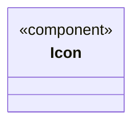

# 共享表现组件

## 设计意图

Icon 的组织操作图形包含返回、新增团队和新增成员，复用既有线性图标风格；文字提示和可访问名称由使用它的按钮提供。

承载跨界面的图标、品牌及基础样式。

## 主要组成

| 组成 | 定位 |
| --- | --- |
| [Icon](Icon.tsx) | 承载跨界面的图标、品牌及基础样式。 |

数据架构沿用 24px 线性图标：数据库入口、实体表、字段、新增数据域／实体／字段。按钮自行提供提示和可访问名称，图形不承担业务操作。

<!-- architecture:generated:start -->

## 架构关系

[上层设计](../ARCHITECTURE.md)

<!-- architecture:generated:end -->

### Office 指令排队

共享 Icon 增加 up/down，配合 grip、enqueue、edit、remove、pause/play 表示队列排序、插入和控制；按钮保留 title 与可访问名称。

### 项目与对话导航

项目侧栏补充 pin、archive、chevronDown/chevronRight 线性图标；动作按钮保留可访问名称及提示，鼠标悬停和键盘聚焦显示快捷入口，触屏常显。
