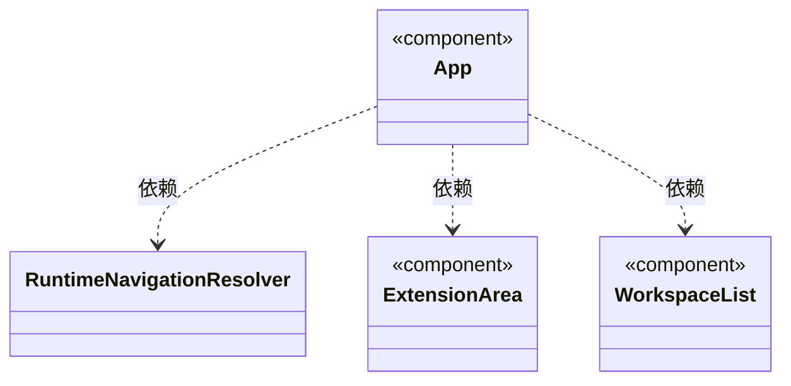

# src/view/shell 架构

## 设计意图

组织窗口布局、工作区与会话导航及全局页面，提供共享界面状态的单一装配入口。

`App` 持有共享选择和轮询，`WorkspaceList` 提供真实工作区/会话入口，`ExtensionArea` 组合独立扩展页，`RuntimeNavigationResolver` 将运行定位映射到已有会话。业务页面按需加载，导航与界面卸载不代替后端工作区关闭。

## 主要组成

| 组成 | 定位 |
| --- | --- |
| [RuntimeNavigationResolver](runtime-navigation.ts) | 把全局运行页的定位目标核对为现有主会话，并只更新本机页签与任务图选择。 |
| [App](App.tsx) | 窗口级界面装配，持有工作区／会话选择、全局页签、布局、轮询和未提交修改提示。 |
| [ExtensionArea](ExtensionArea.tsx) | 工作区右侧扩展页签，独立于中央对话管理浏览器、命令终端、架构与内部运行诊断视图。 |
| [WorkspaceList](WorkspaceList.tsx) | 工作区树、主/子会话导航、主条目管理与工作区浮动操作菜单；子成员只提供观察入口。 |

<!-- architecture:generated:start -->

## 架构关系

[上层设计](../ARCHITECTURE.md)

<!-- architecture:generated:end -->
