# src/view/shell 架构

本目录只维护这一份说明。设计与契约直接编辑本文；文件清单、类图和导航由 [架构脚本](../../../scripts/source-architecture.mjs) 更新，生成区域之外的人工说明会保留。

## 封装意图

工作区侧栏、会话选择、用户栏与右侧扩展页签；会话区与项目级视图区分开。向会话传递活动页签状态，隐藏页签保留草稿/节点选择并降低成员与任务图同步频率。 用户栏更新图标显示版本和进度，仅就绪后显式安装；新版提醒打开详情，原页面与草稿保持挂载。 导航的操作桥按明确请求Schema解析，坏历史记录不能当完整运行。

## 类与模块的设计意图

下表依据源码声明及文件头说明定位封装。字段表示该实例持有的状态或协作引用，不表示它拥有被引用服务的生命周期；实际资源责任和调用限制见下文契约及源码注释。

| 类／模块 | 实现形式与实例字段 | 封装依据 |
| --- | --- | --- |
| [App.tsx](App.tsx) | 组件模块 | 外壳拥有选择与布局状态，对话回调显式绑定原工作区和页签。运行管理只核实并定位原会话，保留草稿，不启动或重试；异步定位遇切屏或实例更换即失效。 |
| [ExtensionArea.tsx](ExtensionArea.tsx) | 组件模块 | 空页签只呈现功能选择；收起保留组件和草稿，关闭才释放终端；业务架构取得真实工作区运行状态以复用岗位登记，静态定义提交后刷新共享快照，动态实例仍归会话任务图。网页用无宿主权限的沙箱 iframe。 |
| [RuntimeNavigationResolver](runtime-navigation.ts) | 实例类；持有 `generation`、`read` | 只读核实；cancel 或更新请求后，迟到成功和失败都不再影响当前页面。 |
| [tabs.ts](tabs.ts) | 函数／契约模块 | 布局、草稿、标题与删除标记按工作区隔离保存；轮询不能复活已移除条目，重命名不改原任务目标或运行证据。 |
| [UserMenu.tsx](UserMenu.tsx) | 组件模块 | 菜单提供外观快捷切换与账号设置直达；外观和更新状态仍由外壳唯一持有。 |
| [useSidebarWidth.ts](useSidebarWidth.ts) | 函数／契约模块 | 参照 Cindy 的 260px 默认宽度和 4px 拖动边缘；不改变工作区选中或服务状态。 |
| [WorkspaceList.tsx](WorkspaceList.tsx) | 组件模块 | 名称与折叠按钮相邻，菜单以点击点为左上锚定并在视口边缘避让，不受滚动侧栏裁切。对话操作只委托上层本机布局。 |

## 接口设计契约

### 工作区外壳与原会话定位

App 和 ExtensionArea 的八个专业页面使用局部延迟入口，统一显示加载和失败重试；原已挂载隐藏扩展仍保留，恢复隐藏页签也可能加载模块。设置草稿只汇总布尔值，离开/返回/窗口关闭先提示；拒绝选择时侧栏回调立即返回，不继续更换子会话。自动化位于扩展区且隐藏停止轮询，保留上游双态交互区和频道，不恢复已退出的独立任务图。

外壳按工作区实例与主 Session 缓存对话页面发布的已验证成员投影。主条目始终可见，成员在其下以名称直接选择；点击成员保留主页签/taskId，仅设置本机查看身份，点击主条目恢复主聊天及已选频道。子会话无创建、重命名和删除操作；工作区重新打开后的实例不复用旧动态缓存。主聊天草稿和发送归属仍由原主页签持有，频道草稿由交互区按原 workspace/root/scope 独立保存。

对话列表与会话历史菜单共用 `ConversationEntries` 和本机 `TabLayout`：自定义标题不覆盖原任务目标，移除条目保存工作区隔离的 `hiddenTaskIds`，轮询和重开不复活；删除最后一项创建空对话，不停止后台运行或删除日志。运行总览的显式定位可以恢复被移除条目。红色运行灯取 `runtime.snapshot` 的 ready 工作区及实际主／成员 running 记录，排队、历史状态和持久等待不点亮，读取失败清除观察。工作区菜单使用 portal 以点击坐标锚定左上角，视口边缘避让，支持键盘与焦点返回；折叠按钮紧邻项目名。

`ExtensionArea` 向业务架构传递完整的 `WorkspaceView` 与共享快照，使负责人入口复用项目岗位登记时仍核实真实运行状态和实例。登记、返回原模块及选择状态由业务视图持有；外壳不生成岗位或执行责任写入。

`App` 保存工作区页签、草稿与附件，界面选择不代表后端运行。全局“运行管理”挂载独立只读 `RuntimeOverview`；离开该页卸载其读取，不创建或恢复任务。

首页和设置中心共享 components/sidebar.css 的侧栏视觉规则。App 的唯一 useSidebarWidth 通过 --sidebar-width 提供当前宽度，并向设置传入相同调整手柄；拖动、键盘调整和本机持久化共用同一状态，不随进入设置重置。设置窄屏导航继续由自身内容布局处理。

展开侧栏仅显示“团队空间”文字及收起按钮，不重复展示 CBIM/BrandMark；窄侧栏也保留文字。欢迎页仍展示完整名称 CBIM Assistant 与 BrandMark。标题变化不改变账号、工作区、侧栏伸缩或品牌资源。

用户栏右侧原主题按钮改为常驻更新图标；账号菜单提供设置、主题快捷切换、账号与外观直达，不重复更新入口或绿点。`App` 持有唯一 `useSoftwareUpdates`，把同一个 controller 交给 `UserMenu` 内的 `SoftwareUpdateButton`、新版提醒和详情。图标悬停或聚焦只读版本和进度；仅 ready 时点击安装，未就绪不打开弹窗、不下载、不排队安装。具体进度环、呼吸与错误语义归 updates。主题切换仍由 UserMenu 的菜单项调用原回调。详情从新版提醒或设置的关于页打开，不切换 screen 或卸载原会话和设置草稿。

更新呈现独立归入 [updates](../updates/ARCHITECTURE.md)，通过固定 IPC 依赖公开更新契约，不将账号登录、菜单展示或弹窗状态放进 logic/updates/service。菜单位置是本次已确认的变化点；检查、下载与排空安装的规则保持原后端归属，变化频率没有统计结论。

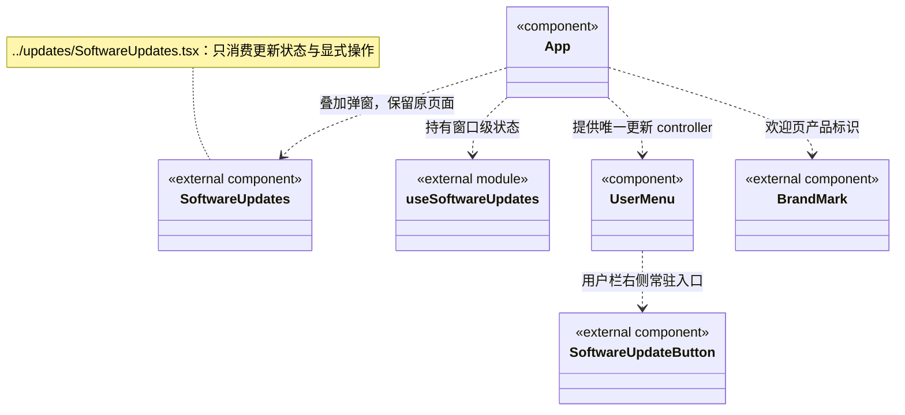

运行页的 `onOpen` 只携带 `workspaceId/rootSessionId` 与可选 `scopeId/taskId`。`RuntimeNavigationResolver` 依次读取工作区清单、该工作区的 `loop.list`、再次读取清单，要求同一实例始终为 running，且原根存在真实 chat 记录并属于该工作区。缺失、不可读或身份冲突明确失败，不调用 open、chat、resume、dispatch 或重试接口。

导航只复用已绑定该根的聊天页签；本机没有页签时，新增绑定真实历史的页签，不挪用未发送草稿页签，不改原标题、草稿或附件。两次点击不会建立重复绑定。切屏、新导航和卸载使旧请求失效，迟到失败也不覆盖新页面。工作区实例变化重新挂载会话投影，原本机草稿保持。

一次性 `RuntimeNavigationRequest` 交给 `Conversation`；任务图与周期加载完成后再次核对原身份并消费。选中旧周期仅影响展示，不改变实际开放目标。消费后请求清除，后续轮询或返回对话不会重复重置用户选择；不存在节点和周期不回退为最新目标。

扩展区将真实治理启动回执交给 Shell，按原工作区绑定新会话，不覆盖其他草稿。右上运行绿点与展开工作区详情入口已移除；工作区管理在左侧更多菜单中保留，不删除后台状态或既有任务。团队文件编辑与业务编辑共用页签离开保护。

#### 自动化会话定位

App 将自动化历史的真实 taskId 交给 showStartedTask，复用已有会话或新建条目，保留原草稿和附件；不重新运行任务。自动化从右侧扩展区的空页签选择打开；收起或切走停止只读轮询，不停止后台计划，不建立第二份配置或调度服务。

##### 异步结果失效边界

RuntimeNavigationResolver 组合前端 AsyncGeneration；每次 resolve 和 cancel 推进代次，列表、会话记录与二次运行列表的 await 后分别检查，过期成功或失败均不影响当前定位。标记只作前端迟到隔离；目标白名单、运行实例重核验、原会话绑定及 requestId 的业务序号保持。
主/子 Agent 入口由 `showAgentChat` 更新逻辑子 Session 选择，保留该主会话当前的对话/办公室模式。首次进入默认对话；办公室人物的显式入口才返回文字页。选择按原页签隔离，不改变 taskId、草稿、模型或后端执行。共用角色投影归 execution-view/team-conversations。

#### 设置中心与本机外观

App 持有 SettingsSectionId 与 useAppearance；进入设置时隐藏原工作区侧栏和顶栏，保留原工作区、会话与侧栏展开状态，返回后恢复原显示。模型配置入口直达大模型，资源页面入口直达资源仓库；导航仍经过原未保存知识编辑检查且只检查一次。分类切换由 SettingsView 保留已访问表单；离开中心维持原卸载语义。UserMenu 消费已解析配色，切换回调写入同一个外观控制器，账号入口不触发登录。关于页与原侧栏更新组件共享一份更新 controller。

#### 统一排版（2026-11-16）

普通文字、按钮、状态和说明复用 components/interface.css 的 --font-ui 与 --weight-regular；结构短标题使用 --weight-medium。颜色和间距承担次要信息层级，不把说明文字缩小。代码使用 --font-code，真实 Markdown 标题保留语义层级。

## 开闭边界

本目录的职责及允许协作由[封装意图](#封装意图)限定，输入输出、状态与失败语义以[接口设计契约](#接口设计契约)为准。扩展从已有公开入口及实际装配位置进入；没有明确可替换契约的部分按真实影响修改和验证，不预建未使用的基类或插件入口。

<!-- architecture:generated:start -->

## 文件清单

| 文件 | 形式 | 当前职责 |
| --- | --- | --- |
| [ARCHITECTURE.md](ARCHITECTURE.md) | 说明文档 | 本目录的文件清单、真实声明、依赖与子封装导航。 |
| [App.tsx](App.tsx) | 组件模块 | 桌面外壳：工作区下展示对话，中间固定主 Agent 会话（对话/任务视图），右侧独立扩展区承载架构/流程等视图；可调整宽度的侧边栏、工作区选择、页签、轮询、全局页面和未提交修改提示。 |
| [ExtensionArea.tsx](ExtensionArea.tsx) | 组件模块 | 工作区右侧扩展页签，独立于中央对话管理浏览器、命令终端、架构与内部运行诊断视图。 |
| [UserMenu.tsx](UserMenu.tsx) | 组件模块 | 本地账号、主题与设置菜单；用户栏右侧装配独立的版本更新图标。 |
| [WorkspaceList.tsx](WorkspaceList.tsx) | 组件模块 | 工作区树、主/子会话导航、主条目管理与工作区浮动操作菜单；子成员只提供观察入口。 |
| [extensions.css](extensions.css) | 样式 | 中央对话与右侧扩展区的分栏、空页签及各扩展面板布局。 |
| [runtime-navigation.ts](runtime-navigation.ts) | 源码模块 | 把全局运行页的定位目标核对为现有主会话，并只更新本机页签与任务图选择。 |
| [shell.css](shell.css) | 样式 | 工作区外壳、侧栏、页签、菜单和主题布局样式。 |
| [tabs.ts](tabs.ts) | 源码模块 | 页签种类、默认布局、排序与本机布局恢复。 |
| [useSidebarWidth.ts](useSidebarWidth.ts) | 源码模块 | 管理侧边栏宽度、拖动与键盘调整，并在本地保留布局。 |
| [workspace-list.css](workspace-list.css) | 样式 | 工作区树、名称旁的折叠按钮及点击位置浮动菜单。 |

## 架构类图

成员标记：`+` 公开、`-` 私有、`#` 受保护、`$` 静态；`function` 为函数值成员，`get`／`set` 为访问器。调用／构造／索引签名按匿名签名列出，不虚构方法名；`global.` 表示全局声明补充，非运行时嵌套类。构造函数单独列出，运行时私有字段保留 `#`。文档和资源仅在文件清单中导航，不作为代码节点。

### App.tsx

[查看源码](App.tsx)。

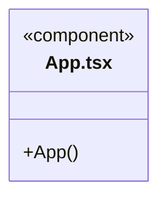

直接依赖：[../../bridge/contracts/ipc-call.ts](../../bridge/contracts/ipc-call.ts)、[../../bridge/contracts/resources.ts](../../bridge/contracts/resources.ts)、[../../bridge/contracts/workspace.ts](../../bridge/contracts/workspace.ts)、[../components/BrandMark.tsx](../components/BrandMark.tsx)、[../components/DeferredView.tsx](../components/DeferredView.tsx)、[../components/Empty.tsx](../components/Empty.tsx)、[../components/Icon.tsx](../components/Icon.tsx)、[../components/InterfaceHelp.tsx](../components/InterfaceHelp.tsx)、[../components/sidebar.css](../components/sidebar.css)、[../conversation/Conversation.tsx](../conversation/Conversation.tsx)、[../conversation/conversation-activity.ts](../conversation/conversation-activity.ts)、[../execution-view/team-conversations.ts](../execution-view/team-conversations.ts)、[../resources/ResourceRepositoryView.tsx](../resources/ResourceRepositoryView.tsx)、[../runtime/RuntimeOverview.tsx](../runtime/RuntimeOverview.tsx)、[../runtime/runtime-view-state.ts](../runtime/runtime-view-state.ts)、[../settings/SettingsView.tsx](../settings/SettingsView.tsx)、[../settings/settings-sections.ts](../settings/settings-sections.ts)、[../settings/useAppearance.ts](../settings/useAppearance.ts)、[ExtensionArea.tsx](ExtensionArea.tsx)、[UserMenu.tsx](UserMenu.tsx)、[WorkspaceList.tsx](WorkspaceList.tsx)、[runtime-navigation.ts](runtime-navigation.ts)、[tabs.ts](tabs.ts)、[useSidebarWidth.ts](useSidebarWidth.ts)、[../updates/SoftwareUpdates.tsx](../updates/SoftwareUpdates.tsx)、[../updates/useSoftwareUpdates.ts](../updates/useSoftwareUpdates.ts)。

### ExtensionArea.tsx

[查看源码](ExtensionArea.tsx)。

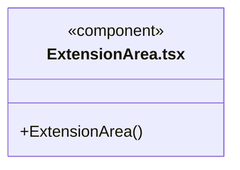

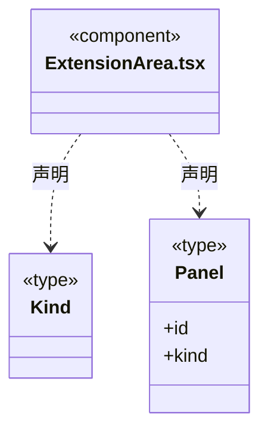

直接依赖：[../../bridge/contracts/workspace.ts](../../bridge/contracts/workspace.ts)、[../automation/AutomationView.tsx](../automation/AutomationView.tsx)、[../components/DeferredView.tsx](../components/DeferredView.tsx)、[../components/Icon.tsx](../components/Icon.tsx)、[../diagnostics/WorkspaceDiagnostics.tsx](../diagnostics/WorkspaceDiagnostics.tsx)、[extensions.css](extensions.css)、[../team/TeamView.tsx](../team/TeamView.tsx)、[../workspace/WorkspaceView.tsx](../workspace/WorkspaceView.tsx)。

### extensions.css

[查看源码](extensions.css)。

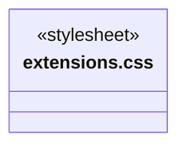

### runtime-navigation.ts

[查看源码](runtime-navigation.ts)。

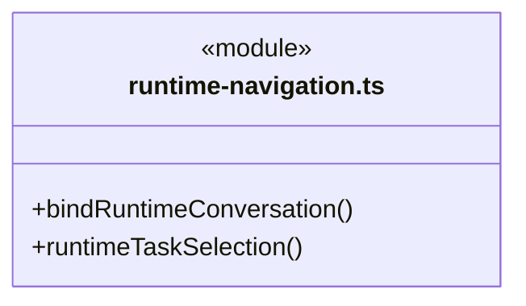

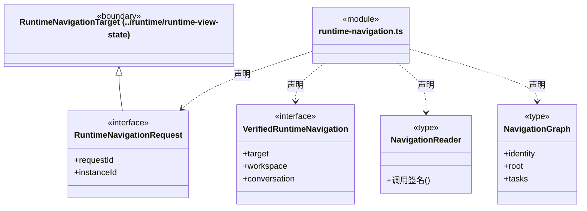

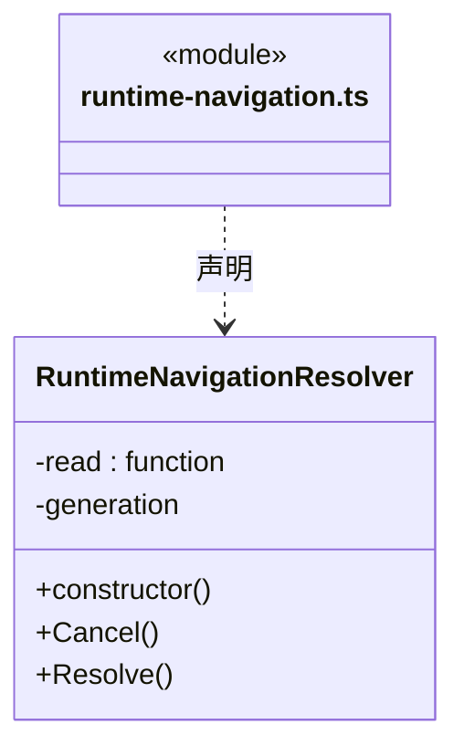

匿名签名（NavigationReader，不是具名方法）：`(action: 'list' | 'loop.list', args?: { id: string }) => Promise<unknown>`。
继承／实现来源：`RuntimeNavigationTarget` → [../runtime/runtime-view-state.ts](../runtime/runtime-view-state.ts)（声明 `RuntimeNavigationTarget`）。
直接依赖：[../../bridge/contracts/dispatch.ts](../../bridge/contracts/dispatch.ts)、[../../bridge/contracts/workspace.ts](../../bridge/contracts/workspace.ts)、[../foundations/utility/index.ts](../foundations/utility/index.ts)、[../runtime/runtime-view-state.ts](../runtime/runtime-view-state.ts)、[tabs.ts](tabs.ts)。

### shell.css

[查看源码](shell.css)。

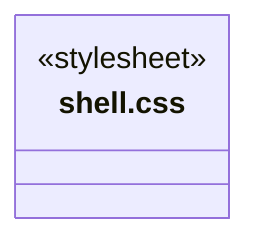

### tabs.ts

[查看源码](tabs.ts)。

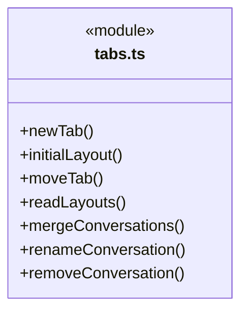

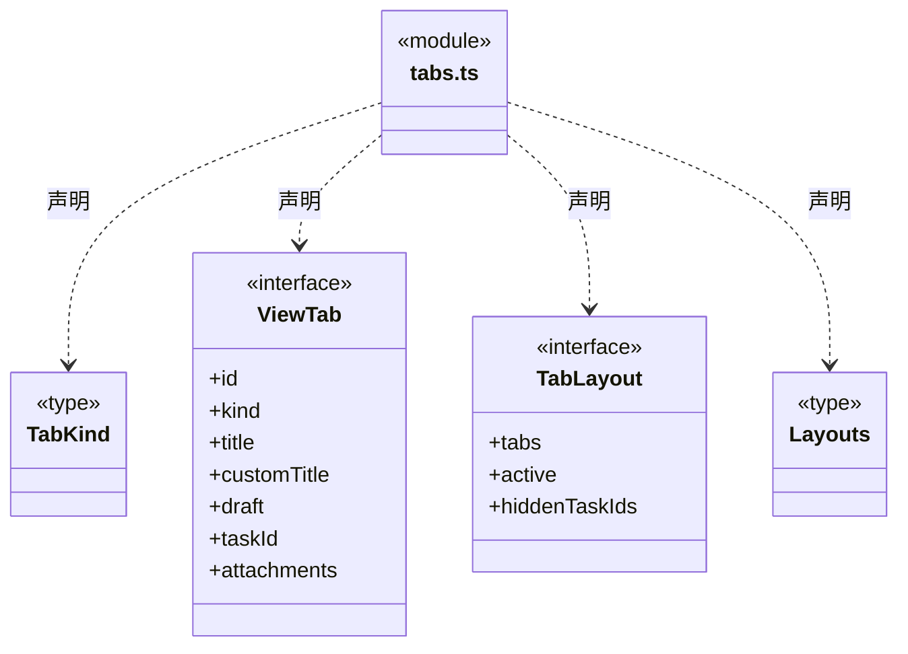

直接依赖：[../../bridge/contracts/chat.ts](../../bridge/contracts/chat.ts)。

### UserMenu.tsx

[查看源码](UserMenu.tsx)。

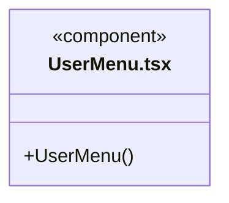

直接依赖：[../components/Icon.tsx](../components/Icon.tsx)、[../settings/settings-sections.ts](../settings/settings-sections.ts)、[../updates/SoftwareUpdateButton.tsx](../updates/SoftwareUpdateButton.tsx)、[../updates/useSoftwareUpdates.ts](../updates/useSoftwareUpdates.ts)。

### useSidebarWidth.ts

[查看源码](useSidebarWidth.ts)。

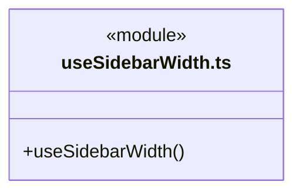

### workspace-list.css

[查看源码](workspace-list.css)。

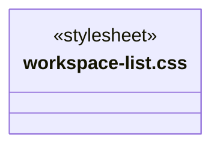

### WorkspaceList.tsx

[查看源码](WorkspaceList.tsx)。

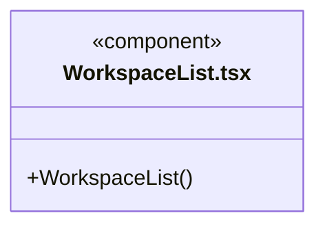

直接依赖：[../../bridge/contracts/workspace.ts](../../bridge/contracts/workspace.ts)、[../components/Icon.tsx](../components/Icon.tsx)、[../components/state-labels.ts](../components/state-labels.ts)、[../conversation/ConversationEntries.tsx](../conversation/ConversationEntries.tsx)、[../execution-view/team-conversations.ts](../execution-view/team-conversations.ts)、[tabs.ts](tabs.ts)、[workspace-list.css](workspace-list.css)。

### 本目录调用边界

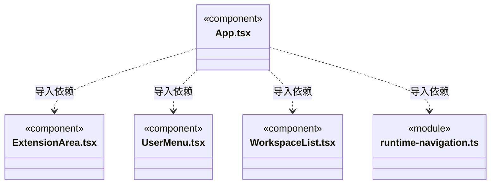

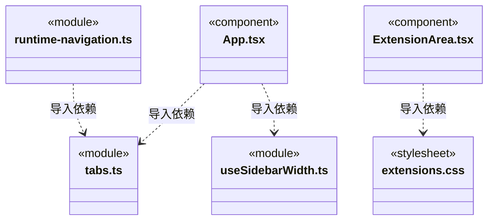

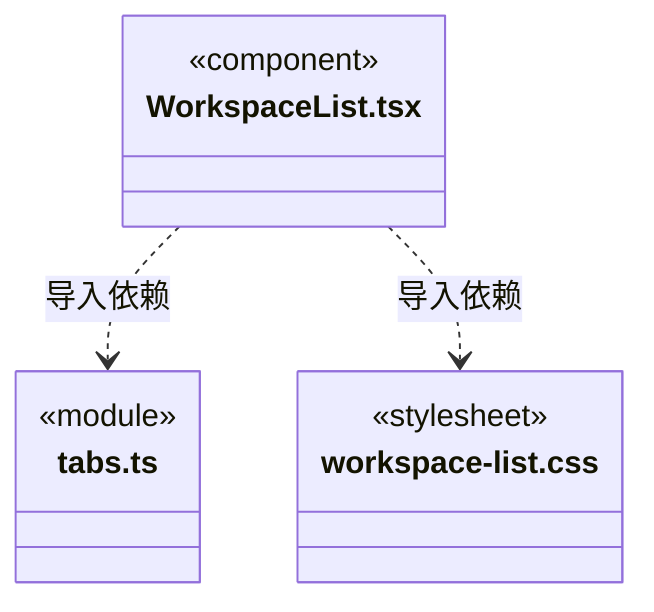

## 子目录导航

无子目录。

[返回上层](../ARCHITECTURE.md)。

每次修改本目录代码，同步维护文件头、关键契约说明及本图。未实现的治理、证据验收和自动编排能力不列入当前类图。

<!-- architecture:generated:end -->
