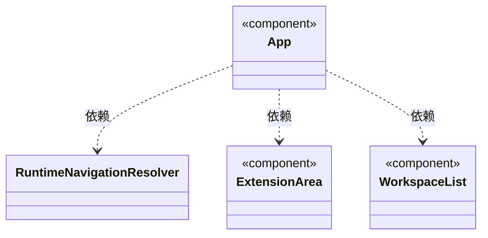

# src/view/shell 架构

## 设计意图

组织应用窗口、工作区导航、会话区与扩展页面。App 持有共享界面状态，导航解析器把运行身份映射到已有视图，具体业务交互由页面模块承担。

## 主要组成

| 组成 | 定位 |
| --- | --- |
| [RuntimeNavigationResolver](runtime-navigation.ts) | 把全局运行页的定位目标核对为现有主会话，并只更新本机页签与任务图选择。 |
| [App](App.tsx) | 桌面外壳：工作区下展示对话，中间固定主 Agent 会话（对话/任务视图），右侧独立扩展区承载架构/流程等视图；可调整宽度的侧边栏、工作区选择、页签、轮询、全局页面和未提交修改提示。 |
| [ExtensionArea](ExtensionArea.tsx) | 工作区右侧扩展页签，独立于中央对话管理浏览器、命令终端、架构与内部运行诊断视图。 |
| [WorkspaceList](WorkspaceList.tsx) | 工作区树、主/子会话导航、主条目管理与工作区浮动操作菜单；子成员只提供观察入口。 |

<!-- architecture:generated:start -->

## 架构关系

[上层设计](../ARCHITECTURE.md)

<!-- architecture:generated:end -->
