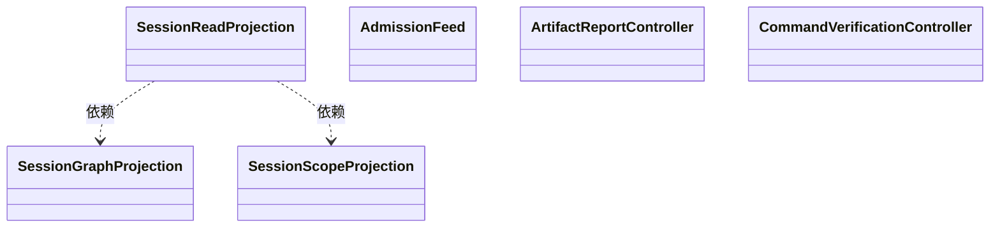
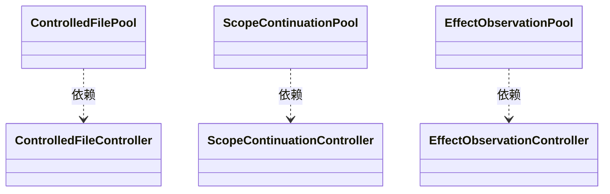
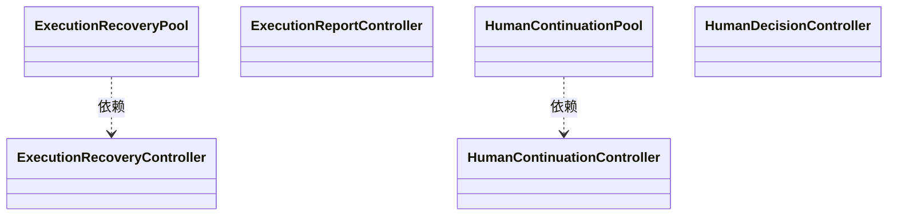
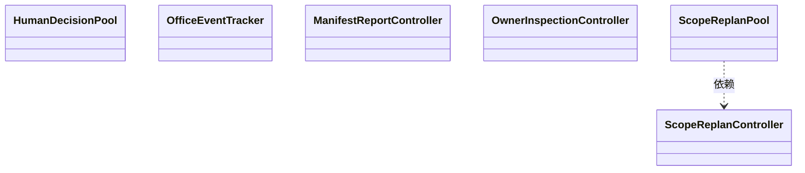
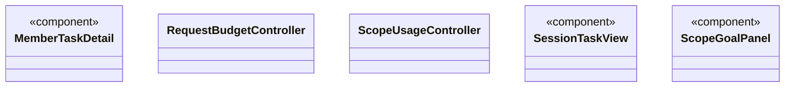

# src/view/tasks 架构

## 设计意图

展示主会话任务与目标的真实投影，并为证据核实、人工决定和显式接续提供交互入口。

图与周期投影先核实身份和游标再统一发布；各命令控制器保存草稿、冻结请求和原回执，Pool 在同一会话视图间共享未决操作。组件消费这些状态并组合 execution-view，业务完成、恢复许可和平台退出始终由后端返回。当前多类控制器仍同处一个实现目录，图中的分组只是阅读分组。

## 主要组成

| 组成 | 定位 |
| --- | --- |
| [AdmissionFeed](admission-state.ts) | 维护当前窗口共享的全局准入快照，供设置与会话提示订阅。 |
| [ArtifactReportController](artifact-report-state.ts) | 成员文件基线列表和显式复核的只读界面状态，校验报告身份及单次观察结果。 |
| [CommandVerificationController](command-verification-state.ts) | 保存一次原主工具调用的显式核实状态，校验报告身份并隔离迟到的异步响应。 |
| [ScopeContinuationController](continuation-state.ts) | 维护单个主会话目标补充的草稿、冻结请求和回执。 |
| [ScopeContinuationPool](continuation-state.ts) | 在同一窗口中按主会话复用补充控制器，保留跨页面在途请求。 |
| [ControlledFileController](controlled-file-state.ts) | 维护主会话的受控文件报告、补偿预览与原命令索引。 |
| [ControlledFilePool](controlled-file-state.ts) | 让节点和页签共享文件处置控制器，只回收空闲实例。 |
| [EffectObservationController](effect-observation-state.ts) | 按原调用保存影响观察、处置草稿与稳定命令。 |
| [EffectObservationPool](effect-observation-state.ts) | 在同一窗口的主工具和任务节点之间共享影响观察控制器。 |
| [ExecutionReportController](execution-report-state.ts) | 验证成员执行核实报告的身份和分页基线，并保存一次显式读取的前端状态。 |
| [SessionGraphProjection](graph-state.ts) | 主会话派发图的前端增量投影，核对身份和游标后原子合并完整提交。 |
| [HumanContinuationController](human-continuation-state.ts) | 维护按真实人工决定继续目标的持久请求与原回执。 |
| [HumanContinuationPool](human-continuation-state.ts) | 让同一主会话的目标卡共享人工接续控制器及在途命令。 |
| [HumanDecisionController](human-decision-state.ts) | 维护人工决定的草稿、预览、冻结命令与回执。 |
| [HumanDecisionPool](human-decision-state.ts) | 按主会话复用人工决定控制器，避免多个卡片独立提交同一操作。 |
| [OfficeEventTracker](office-state.ts) | 把当前办公室已提交任务投影为唯一人物、模块工位及派发/汇报动态。 |
| [ManifestReportController](output-manifest-state.ts) | 完整产物清单的显式列表、选择和复核状态；仅消费 Bridge 公开 DTO。 |
| [OwnerInspectionController](owner-execution-state.ts) | 将任务内冻结的负责人绑定投影为只读展示状态，供对话卡片、任务节点与详情共用。 |
| [ExecutionRecoveryController](recovery-state.ts) | 保存从异常报告新建只读核实周期的草稿、命令与回执。 |
| [ExecutionRecoveryPool](recovery-state.ts) | 跨节点和工作区视图保留核实控制器的在途请求。 |
| [ScopeReplanController](replan-state.ts) | 维护从已完成核实周期创建正式业务周期的预览与稳定提交。 |
| [ScopeReplanPool](replan-state.ts) | 按主会话共享重规划控制器，避免竞争写入同一本机索引。 |
| [RequestBudgetController](request-budget-state.ts) | 管理单一目标的只读请求账本摘要，显式刷新且核对完整身份与冻结策略版本。 |
| [SessionScopeProjection](scope-state.ts) | 维护目标周期摘要与详情的增量投影，校验成功后更新快照。 |
| [SessionReadProjection](scope-state.ts) | 将任务图、周期摘要与详情作为同一批视图提交，避免显示半次响应。 |
| [ScopeUsageController](scope-usage-state.ts) | 管理任务周期用量的一次显式读取，并验证返回身份、计量来源与汇总一致性。 |
| [SessionTaskView](SessionTaskView.tsx) | 展示当前主会话的办公室及用量，人物详情和历史任务只导航对应对话。 |
| [MemberTaskDetail](MemberTaskDetail.tsx) | 展示任务图选中成员的公开正文、工具、计划与候选；独立报告核实执行事实，独立表单显式创建新的只读核实周期。 |
| [ScopeGoalPanel](ScopeGoalPanel.tsx) | 复用展示本轮真实目标、冻结岗位分配、逐项审阅及历史周期，供主对话摘要和任务根详情使用。 |

<!-- architecture:generated:start -->

## 架构关系

### 关系组 1：SessionReadProjection

### 关系组 2：ControlledFileController

### 关系组 3：ExecutionRecoveryController

### 关系组 4：HumanDecisionPool

### 关系组 5：MemberTaskDetail

### 跨图协作

按引用方归并目标，保留全部跨图关系；分图只用于阅读，不表示新增模块或依赖边界。

| 引用方 | 关系 | 目标 |
| --- | --- | --- |
| [HumanDecisionPool](human-decision-state.ts)（图 4） | 依赖 | [HumanDecisionController](human-decision-state.ts)（图 3） |

[上层设计](../ARCHITECTURE.md)

<!-- architecture:generated:end -->
