# src/view/team 架构

## 目录定位

工作区唯一的静态Team/组/Agent图、继承与人才复用，节点按Session查看只读履历。岗位面板独立登记、明确采纳和暂停退休；改名和模型更新保留原能力来源。来源屏障首次拒绝可重新编辑，未知仍查原命令；反查责任委托workspace，不启动模型。 岗位登记支持默认或明确引擎/模型，详情展示冻结引擎。 历史查询按操作关联请求和响应，分页状态与原迟到隔离保持；Markdown 复用 execution-view。 当前岗位启用不是运行许可，真正执行还核模块责任和原计划；编辑不会搬运历史。

本文描述当前实现。通过分析目录边界后维护的 [源码架构脚本](../../../scripts/source-architecture.mjs) 同步清单和声明；代码变更时仍须核对职责、关键成员与关系。

## 代码清单

| 文件 | 当前职责 |
| --- | --- |
| [agent-history-state.ts](agent-history-state.ts) | 校验并合并角色执行历史的会话/轮次分页，生成完整身份观察键。 |
| [agent-history.css](agent-history.css) | 对应界面的布局与视觉样式。 |
| [AgentSessionHistory.tsx](AgentSessionHistory.tsx) | 在静态 Agent 下浏览长期 Session 履历，按独立会话和运行展示公开消息、工具过程与计划证据。 |
| [MainAgentEditor.tsx](MainAgentEditor.tsx) | 团队页面的主 Agent 引擎/模型配置入口。 |
| [team-model.ts](team-model.ts) | 从工作区知识快照构建静态 Team、分组、Agent 与 Skill 视图模型。 |
| [team-view.css](team-view.css) | 对应界面的布局与视觉样式。 |
| [TeamView.tsx](TeamView.tsx) | 静态团队架构、知识编辑与人才市场入口；独立打开角色 Session 履历和项目岗位登记。 |
| [useAgentHistory.ts](useAgentHistory.ts) | 为只读角色历史面板提供按需分页与单轮公开事件读取。 |
| [useMainAgentSettings.ts](useMainAgentSettings.ts) | 对话栏与主 Agent 配置页共用的配置读取、保存和同步 Hook。 |
| [workspace-member-state.ts](workspace-member-state.ts) | 项目岗位页面的严格回包核对与持久提交控制器；跨同工作区页面共享未决命令。 |
| [workspace-members.css](workspace-members.css) | 对应界面的布局与视觉样式。 |
| [WorkspaceMemberDetail.tsx](WorkspaceMemberDetail.tsx) | 只读展示项目岗位的稳定身份、采纳内容与本次核实的外部差异。 |
| [WorkspaceMemberForm.tsx](WorkspaceMemberForm.tsx) | 项目岗位登记、元信息编辑、明确采纳及状态变更的表单。 |
| [WorkspaceMembers.tsx](WorkspaceMembers.tsx) | 团队与业务架构共用的项目岗位登记面板，浏览采纳差异、显式变更，并反查负责的模块。 |

## 架构类图

### agent-history-state.ts

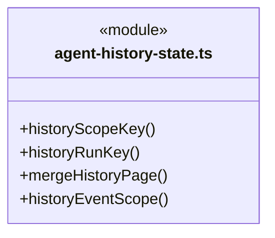

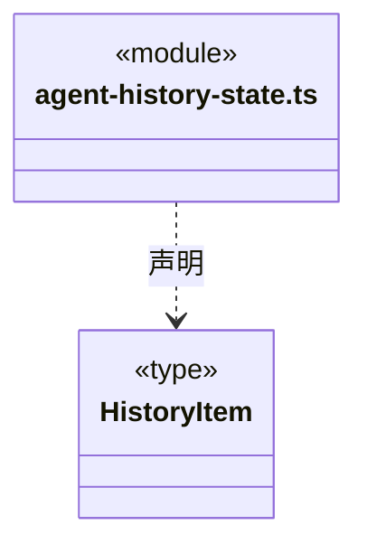

直接依赖：[../../bridge/contracts/agent-history.ts](../../bridge/contracts/agent-history.ts)、[../tasks/member-event-state.ts](../tasks/member-event-state.ts)。

### agent-history.css

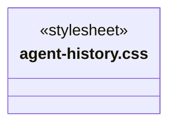

### AgentSessionHistory.tsx

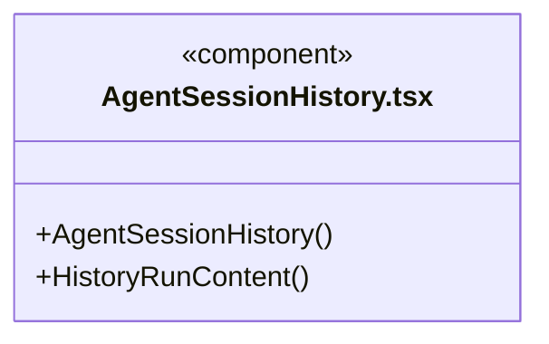

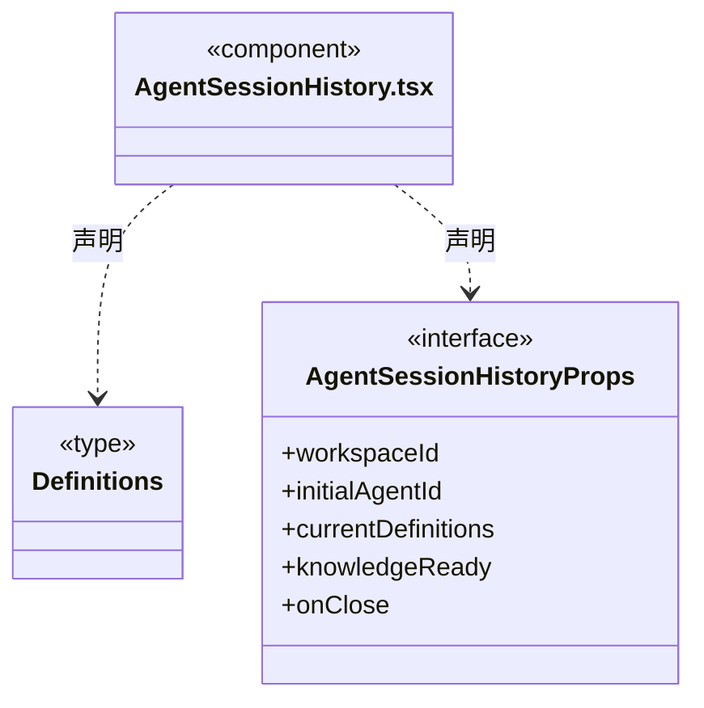

直接依赖：[../../bridge/contracts/agent-history.ts](../../bridge/contracts/agent-history.ts)、[../../bridge/contracts/execution.ts](../../bridge/contracts/execution.ts)、[../tasks/MemberRunTranscript.tsx](../tasks/MemberRunTranscript.tsx)、[../execution-view/transcript.ts](../execution-view/transcript.ts)、[../execution-view/MarkdownMessage.tsx](../execution-view/MarkdownMessage.tsx)、[agent-history-state.ts](agent-history-state.ts)、[useAgentHistory.ts](useAgentHistory.ts)、[agent-history.css](agent-history.css)、[../tasks/member-activity.css](../tasks/member-activity.css)。

### MainAgentEditor.tsx

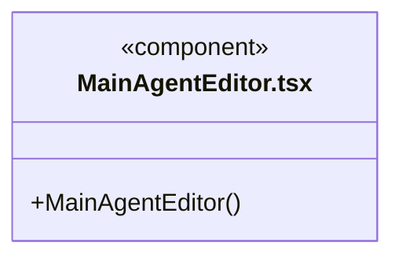

直接依赖：[../../bridge/contracts/workspace.ts](../../bridge/contracts/workspace.ts)、[../../bridge/contracts/models.ts](../../bridge/contracts/models.ts)、[../../bridge/contracts/agent-settings.ts](../../bridge/contracts/agent-settings.ts)、[../components/EngineModelPicker.tsx](../components/EngineModelPicker.tsx)、[useMainAgentSettings.ts](useMainAgentSettings.ts)。

### team-model.ts

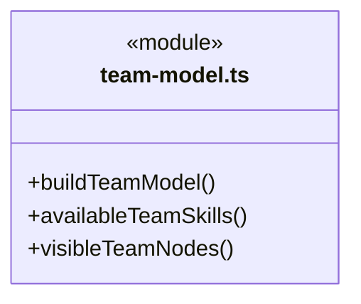

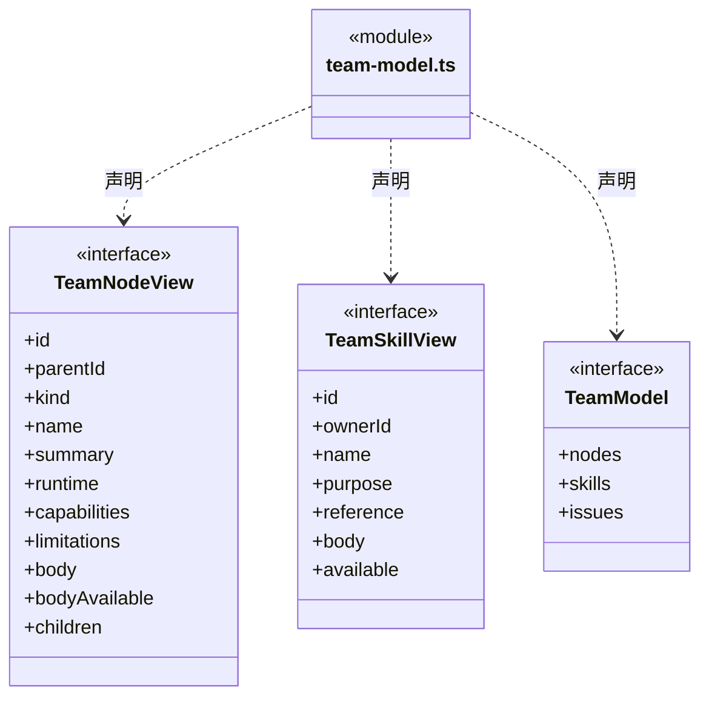

直接依赖：[../../bridge/contracts/agent-settings.ts](../../bridge/contracts/agent-settings.ts)、[../../bridge/contracts/workspace.ts](../../bridge/contracts/workspace.ts)、[../knowledge/static-owners.ts](../knowledge/static-owners.ts)。

### team-view.css

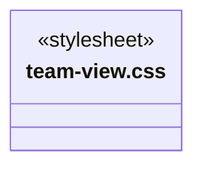

### TeamView.tsx

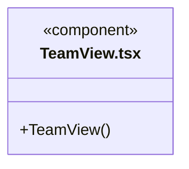

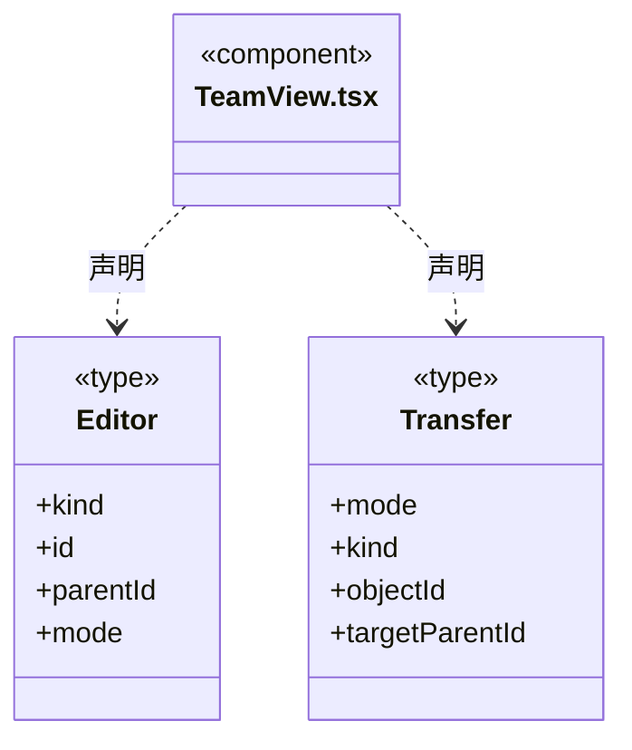

直接依赖：[../../bridge/contracts/workspace.ts](../../bridge/contracts/workspace.ts)、[../components/Icon.tsx](../components/Icon.tsx)、[../knowledge/KnowledgeFileTree.tsx](../knowledge/KnowledgeFileTree.tsx)、[../knowledge/KnowledgeFilePreview.tsx](../knowledge/KnowledgeFilePreview.tsx)、[../knowledge/GovernanceLaunch.tsx](../knowledge/GovernanceLaunch.tsx)、[../execution-view/MarkdownMessage.tsx](../execution-view/MarkdownMessage.tsx)、[../knowledge/ArchitectureEditor.tsx](../knowledge/ArchitectureEditor.tsx)、[../resources/WorkspaceResourceTransfer.tsx](../resources/WorkspaceResourceTransfer.tsx)、[AgentSessionHistory.tsx](AgentSessionHistory.tsx)、[MainAgentEditor.tsx](MainAgentEditor.tsx)、[WorkspaceMembers.tsx](WorkspaceMembers.tsx)、[team-model.ts](team-model.ts)、[team-view.css](team-view.css)。

### useAgentHistory.ts

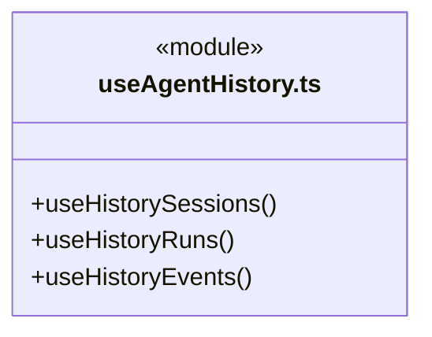

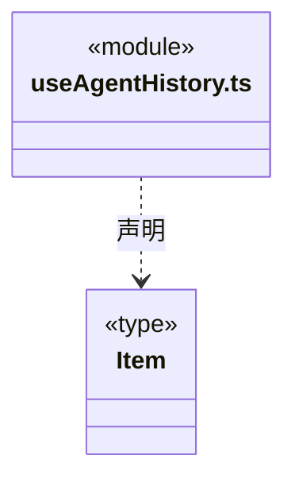

直接依赖：[../../bridge/contracts/agent-history.ts](../../bridge/contracts/agent-history.ts)、[../tasks/member-event-state.ts](../tasks/member-event-state.ts)、[agent-history-state.ts](agent-history-state.ts)。

### useMainAgentSettings.ts

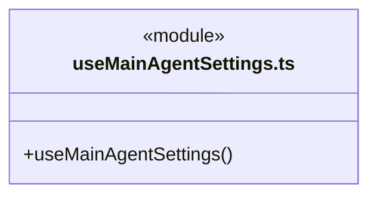

直接依赖：[../../bridge/contracts/agent-settings.ts](../../bridge/contracts/agent-settings.ts)。

### workspace-member-state.ts

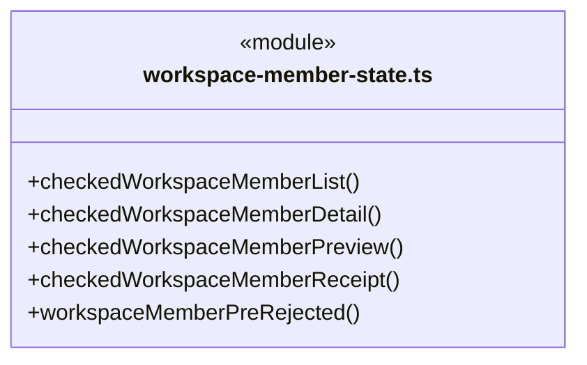

成员 1/2（同名节点为同一声明，跨图合并阅读）。

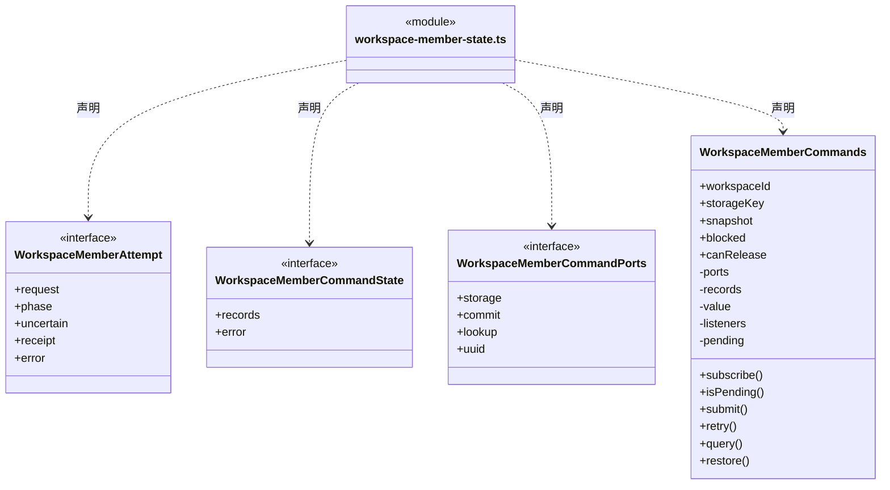

成员 2/2（同名节点为同一声明，跨图合并阅读）。

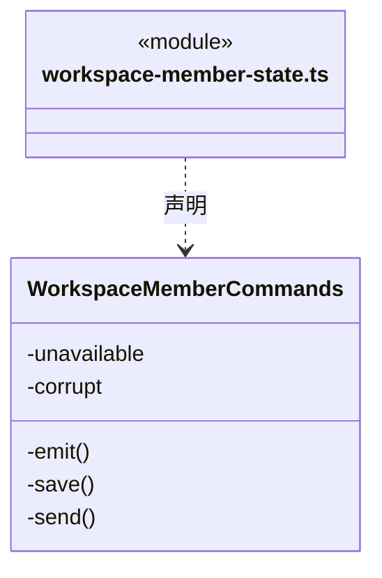

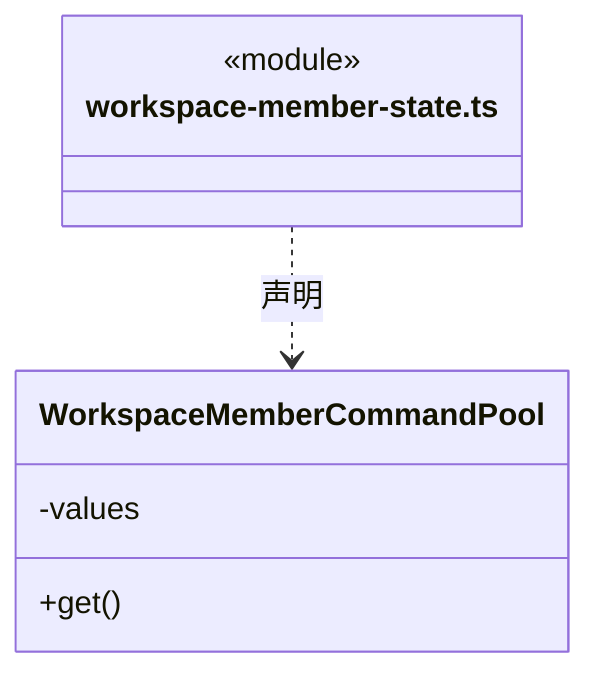

直接依赖：[../foundations/utility/index.ts](../foundations/utility/index.ts)、[../../bridge/contracts/workspace-members.ts](../../bridge/contracts/workspace-members.ts)。

### workspace-members.css

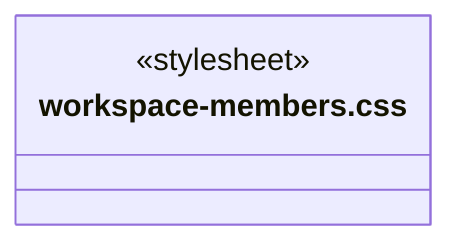

### WorkspaceMemberDetail.tsx

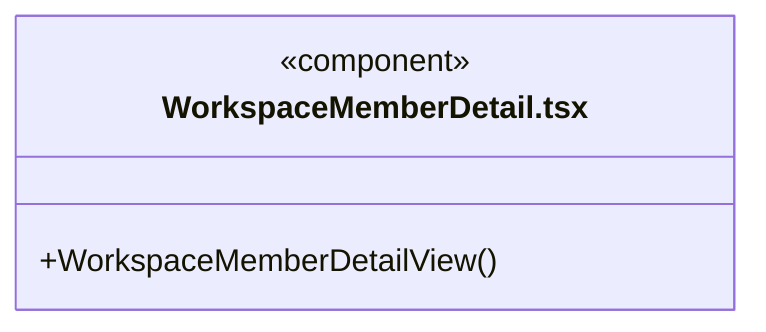

直接依赖：[../../bridge/contracts/engines.ts](../../bridge/contracts/engines.ts)、[../../bridge/contracts/workspace-members.ts](../../bridge/contracts/workspace-members.ts)、[../knowledge/KnowledgeSourceDetails.tsx](../knowledge/KnowledgeSourceDetails.tsx)。

### WorkspaceMemberForm.tsx

```mermaid
classDiagram
class N_src_view_team_WorkspaceMemberForm_tsx["WorkspaceMemberForm.tsx"] {
  <<component>>
  +WorkspaceMemberForm()
}
```

```mermaid
classDiagram
class N_src_view_team_WorkspaceMemberForm_tsx["WorkspaceMemberForm.tsx"] {
  <<component>>
}
class N_src_view_team_WorkspaceMemberForm_tsx_WorkspaceMemberFormProps["WorkspaceMemberFormProps"] {
  <<interface>>
  +kind
  +member
  +agents
  +initialAgentId
  +models
  +target
  +nextState
  +disabled
  +onEdit
  +onPreview
  +onClose
}
N_src_view_team_WorkspaceMemberForm_tsx ..> N_src_view_team_WorkspaceMemberForm_tsx_WorkspaceMemberFormProps : 声明
```

直接依赖：[../components/EngineModelPicker.tsx](../components/EngineModelPicker.tsx)、[../../bridge/contracts/engines.ts](../../bridge/contracts/engines.ts)、[../../bridge/contracts/agent-settings.ts](../../bridge/contracts/agent-settings.ts)、[../../bridge/contracts/models.ts](../../bridge/contracts/models.ts)、[../../bridge/contracts/workspace-members.ts](../../bridge/contracts/workspace-members.ts)。

### WorkspaceMembers.tsx

```mermaid
classDiagram
class N_src_view_team_WorkspaceMembers_tsx["WorkspaceMembers.tsx"] {
  <<component>>
  +WorkspaceMembers()
}
```

```mermaid
classDiagram
class N_src_view_team_WorkspaceMembers_tsx["WorkspaceMembers.tsx"] {
  <<component>>
}
class N_src_view_team_WorkspaceMembers_tsx_WorkspaceMemberAgentOption["WorkspaceMemberAgentOption"] {
  <<interface>>
  +id
  +name
  +runtime
}
N_src_view_team_WorkspaceMembers_tsx ..> N_src_view_team_WorkspaceMembers_tsx_WorkspaceMemberAgentOption : 声明
class N_src_view_team_WorkspaceMembers_tsx_WorkspaceMembersProps["WorkspaceMembersProps"] {
  <<interface>>
  +workspace
  +agents
  +onClose
  +initialRegistration
  +onRegistered
  +returnLabel
}
N_src_view_team_WorkspaceMembers_tsx ..> N_src_view_team_WorkspaceMembers_tsx_WorkspaceMembersProps : 声明
```

直接依赖：[../../bridge/contracts/engines.ts](../../bridge/contracts/engines.ts)、[../../bridge/contracts/workspace.ts](../../bridge/contracts/workspace.ts)、[../../bridge/contracts/models.ts](../../bridge/contracts/models.ts)、[../../bridge/contracts/workspace-members.ts](../../bridge/contracts/workspace-members.ts)、[workspace-member-state.ts](workspace-member-state.ts)、[WorkspaceMemberForm.tsx](WorkspaceMemberForm.tsx)、[WorkspaceMemberDetail.tsx](WorkspaceMemberDetail.tsx)、[../workspace/ModuleOwnershipPanel.tsx](../workspace/ModuleOwnershipPanel.tsx)、[../knowledge/KnowledgeSourceDetails.tsx](../knowledge/KnowledgeSourceDetails.tsx)、[workspace-members.css](workspace-members.css)、[../../bridge/contracts/agent-settings.ts](../../bridge/contracts/agent-settings.ts)。

### 本目录调用边界

```mermaid
classDiagram
class N_src_view_team_AgentSessionHistory_tsx["AgentSessionHistory.tsx"] {
  <<component>>
}
class N_src_view_team_agent_history_state_ts["agent-history-state.ts"] {
  <<module>>
}
class N_src_view_team_useAgentHistory_ts["useAgentHistory.ts"] {
  <<module>>
}
class N_src_view_team_agent_history_css["agent-history.css"] {
  <<stylesheet>>
}
class N_src_view_team_MainAgentEditor_tsx["MainAgentEditor.tsx"] {
  <<component>>
}
class N_src_view_team_useMainAgentSettings_ts["useMainAgentSettings.ts"] {
  <<module>>
}
N_src_view_team_AgentSessionHistory_tsx ..> N_src_view_team_agent_history_state_ts : 导入依赖
N_src_view_team_AgentSessionHistory_tsx ..> N_src_view_team_useAgentHistory_ts : 导入依赖
N_src_view_team_AgentSessionHistory_tsx ..> N_src_view_team_agent_history_css : 导入依赖
N_src_view_team_MainAgentEditor_tsx ..> N_src_view_team_useMainAgentSettings_ts : 导入依赖
```

```mermaid
classDiagram
class N_src_view_team_TeamView_tsx["TeamView.tsx"] {
  <<component>>
}
class N_src_view_team_AgentSessionHistory_tsx["AgentSessionHistory.tsx"] {
  <<component>>
}
class N_src_view_team_MainAgentEditor_tsx["MainAgentEditor.tsx"] {
  <<component>>
}
class N_src_view_team_WorkspaceMembers_tsx["WorkspaceMembers.tsx"] {
  <<component>>
}
class N_src_view_team_team_model_ts["team-model.ts"] {
  <<module>>
}
N_src_view_team_TeamView_tsx ..> N_src_view_team_AgentSessionHistory_tsx : 导入依赖
N_src_view_team_TeamView_tsx ..> N_src_view_team_MainAgentEditor_tsx : 导入依赖
N_src_view_team_TeamView_tsx ..> N_src_view_team_WorkspaceMembers_tsx : 导入依赖
N_src_view_team_TeamView_tsx ..> N_src_view_team_team_model_ts : 导入依赖
```

```mermaid
classDiagram
class N_src_view_team_TeamView_tsx["TeamView.tsx"] {
  <<component>>
}
class N_src_view_team_team_view_css["team-view.css"] {
  <<stylesheet>>
}
class N_src_view_team_useAgentHistory_ts["useAgentHistory.ts"] {
  <<module>>
}
class N_src_view_team_agent_history_state_ts["agent-history-state.ts"] {
  <<module>>
}
class N_src_view_team_WorkspaceMembers_tsx["WorkspaceMembers.tsx"] {
  <<component>>
}
class N_src_view_team_workspace_member_state_ts["workspace-member-state.ts"] {
  <<module>>
}
class N_src_view_team_WorkspaceMemberForm_tsx["WorkspaceMemberForm.tsx"] {
  <<component>>
}
N_src_view_team_TeamView_tsx ..> N_src_view_team_team_view_css : 导入依赖
N_src_view_team_useAgentHistory_ts ..> N_src_view_team_agent_history_state_ts : 导入依赖
N_src_view_team_WorkspaceMembers_tsx ..> N_src_view_team_workspace_member_state_ts : 导入依赖
N_src_view_team_WorkspaceMembers_tsx ..> N_src_view_team_WorkspaceMemberForm_tsx : 导入依赖
```

```mermaid
classDiagram
class N_src_view_team_WorkspaceMembers_tsx["WorkspaceMembers.tsx"] {
  <<component>>
}
class N_src_view_team_WorkspaceMemberDetail_tsx["WorkspaceMemberDetail.tsx"] {
  <<component>>
}
class N_src_view_team_workspace_members_css["workspace-members.css"] {
  <<stylesheet>>
}
N_src_view_team_WorkspaceMembers_tsx ..> N_src_view_team_WorkspaceMemberDetail_tsx : 导入依赖
N_src_view_team_WorkspaceMembers_tsx ..> N_src_view_team_workspace_members_css : 导入依赖
```


## 子目录导航

无子目录。

[返回上层](../ARCHITECTURE.md)。

每次修改本目录代码，同步维护文件头、关键契约说明及本图。未实现的治理、证据验收和自动编排能力不列入当前类图。

## 设计契约 v1 与落地范围

以下内容区分已接通能力与后续设计；以各节的实现状态为准，不将目标图当作现状图。维护源：[CONTRACT.md](CONTRACT.md)；生成类图时同步附加，勿直接修改本附录。

### 团队文件树行尾菜单

Team/分组菜单绑定共享Skill、新建Agent与导入；Team可发布整个团队，Agent行菜单绑定编辑/删除/发布/执行历史与自有Skill，Skill目录菜单绑定其真实owner的编辑/删除/发布。内置角色仍不出现在文件树，没有虚构可编辑节点。跨节点动作捕获所点击的真实路径，原草稿保护、知识事务预览和删除确认保持。独立主Agent设置/历史角色/岗位入口以及Skill详情操作改图标，均保留title/aria-label。展开折叠由共用KnowledgeFileTree管理，不更改模型与岗位状态。

# 静态团队架构契约

WorkspaceMemberForm 在登记/采纳前通过 providerSupportsEngine 验证具体型号的主接口或兼容接口；与共用 EngineModelPicker 和后端快照投影保持一致。只更改岗位元信息不重新采纳模型，已登记岗位的快照仍由显式采纳更新。

## 项目组织树与图内控制

组织树只显示项目 Team、真实分组与自定义 Agent；节点图标优先、统一左对齐并逐层缩进。隐藏内置角色不删定义、不改父链、不修改可调度能力；空项目保留 Team 根及新建提示。展开/折叠由共用 KnowledgeFileTree 管理，只有局部查看状态，不写知识或发起运行；当前文件树不提供图形字号控制。

## 项目岗位登记

业务架构也可复用 `WorkspaceMembers`，以 `initialRegistration` 打开表单并预选仍在当前列表中的 Agent；缺失来源保持未选，不回退到另一能力，模型始终不预选。本次登记取得真实 accepted 回执后才通过 `onRegistered(memberId)` 返回调用方；预览、未知结果、重开恢复或查询旧命令均不触发该回调。团队原入口、同工作区共享命令记录和未知防重规则保持一致；调用方负责原模块选择与单独的负责人保存。

能力详情通过 `KnowledgeSourceDetails` 分开显示内容差异和受控来源身份；登记及“采纳当前能力”的原预览中显示 `sourceSelection`。旧记录未采纳来源时明确提示，不因读取、改名、暂停或模型采纳自动补齐。来源替换即使内容相同，也须明确采纳；此页面不启动岗位执行。

`TeamView` 的“项目岗位”打开独立 `WorkspaceMembers`；稳定岗位不加入静态能力树，也不冒充在线实例。只有当前工作区运行身份可发起新操作；岗位浏览入口不依赖当前知识树是否完整，缺失来源仍可读取历史或停用岗位。页面负责登记和采纳；正式业务派发与领取由调度系统核实，active 不是执行许可，改名或模型设置不热替换旧运行。

列表按登记顺序分页，后续页固定 registry cursor；详情每次明确读取当前能力与公开模型差异。暂停、退休、能力采纳和模型采纳分别预览，编辑元信息不顺带采纳变化。同一静态能力可登记多岗位，`cbim:main` 不可作为业务岗位能力；已采纳原则、继承 Skill 和模型参数按文本只读展示，不执行其中内容。

`WorkspaceMemberForm` 要求明确模型与变更原因，不默认沿用主对话模型。`WorkspaceMembers` 核预览原输入、实例、版本及实际字段；切换对象/编辑字段使旧预览失效，迟到预览不覆盖新选择。列表与详情核完整身份/分页，失败保留明确提示，不根据显示名称改绑岗位。

完整表单仍显式填写模型；模块卡片的快捷选择按已选默认模型登记，规则见 workspace 契约。两入口通过导出的 `workspaceMemberCommands` 池共享未决状态，提交返回自己命令的记录，避免误取并发页面最后一条。

同一 renderer 的同工作区页面共用 `WorkspaceMemberCommands`，先将完整原命令写入本机再提交。未知结果阻止新的岗位写入，只查询或明确重送同一请求；重开仅查询，不预览或提交。原回执全部字段不可变，只有精确列举的首次提交前拒绝可重新准备。已发生超时后再收到旧依据拒绝仍是未知，不能换 ID。

本机最多保留 128 条命令/2 MiB，超限或损坏明确停止新提交，不删除未知记录。受理后的本机保存失败仍保留原回执，可通过只读查询恢复保存，不声称回滚。后台权威审计与本机命令索引分开；登记、查询、采纳均不创建运行实例或发起模型请求。

岗位详情的“负责的模块”进入同一个 `ModuleOwnershipPanel`，按稳定 memberId 反查当前非空关系；返回后重新读取岗位，不能按静态 Agent 名字猜责任。暂停保留关系；有当前模块责任时后端拒绝退休，首次明确 `MEMBER_OWNERSHIP_ACTIVE` 可回到编辑，若原提交已经未知则仍保留未知，不能换命令重试。责任控制面和岗位登记共用工作区权威 Store，但前端原命令记录分别保存。

- `TeamView` 的组织树仅展示工作区正式 Team、分组、Agent 和 Skill 定义，不把 AgentInstance、在线状态、执行活动或任务图混入树。动态派工仍属于当前会话任务视图；静态 Agent 详情可单独打开只读执行履历。
- `team-model.ts` 只读同一 `Snapshot`，节点身份从知识路径派生，不能被 `agent.json` 内额外的 `id` 覆盖。完整模型保留空 Team 根与 `cbim:main`，不再包含已退役的 `cbim:executor`。组织树通过 `visibleTeamNodes(..., false)` 过滤内置主角色，搜索也不显示内置命中。项目岗位选项、历史角色与 Skill 父链仍使用完整模型；解析失败单独提示。
- 自定义 Agent 可创建、读取、编辑、删除；Team 根和内置主角色不可删除或编辑。主角色由应用维护，不在正式知识中伪造可编辑定义，团队树也不展示“未配置岗位时由主 Agent 执行”这一隐式默认关系。静态能力展示不能声称已加载进某次模型上下文。
- 每个组织节点维护自己的 Skill。Agent/分组可用 Skill 由自身至 Team 根逐级合并，界面明确显示所属节点。继承 Skill 只允许跳转原 owner 维护，不能在当前节点上误删继承内容。
- 所有知识修改交给 `ArchitectureEditor`：基于打开时的快照先校验/预览，再显式提交。Agent 新建需填写归属、目录标识、名称、100–250 非空白字符单行摘要、能力、限制和工作原则正文。
- 发布整个团队从 Team 根发起，单 Agent 和自有 Skill 可分别发布。`WorkspaceResourceTransfer` 仅传输静态知识，使用共享人才仓库；导入由弹窗绑定目标 owner，预览后提交，不加载运行实例、会话或权限。
- 知识提交成功后调用注入的 `refresh` 更新快照；刷新失败提示重试，不将本地草稿伪装为已经加载的正式知识。切换工作区关闭旧编辑窗口并重置选择。
- 编辑与读取不授予执行权限；工具授权仍由可信工作区执行入口处理。

## 静态角色的独立 Session 历史

- Agent/内置角色详情的“执行历史”打开 `AgentSessionHistory`；工具栏“历史角色”读取归档索引，可查询当前已删除或不再登记的角色。历史角色不回填到正式团队树，不影响知识编辑草稿或主对话草稿。
- 读取只使用 `agentHistory.roles / sessions / runs / events`。角色按 `workspaceId + agentId`，Session 按服务端 `sessionId`，正文按 `workspaceId + agentId + sessionId + taskId + runId` 固定。模型原生上下文不合并，不从名称、当前选中会话或当前静态配置推导旧身份。
- 历史名称、执行时 `configurationRevision`、实例 ID、通道 ID、主会话 ID 与当前静态定义分开显示。旧 `legacy:<taskId>` 仅为分组键，缺失的实例/通道明确标为未绑定；不补造主会话引用。历史仍保留已释放执行实例的真实引用。
- `useAgentHistory` 在打开角色/Session 后按需读取元数据，只有选中一轮才请求公开事件；手动刷新与加载更多共享串行请求，切换或卸载丢弃迟到响应。没有每秒全量轮询，终态历史不会持续请求。单次事件补读最多 100 页（每页 200 条），更长记录保留游标供继续加载。
- `agent-history-state.ts` 校验分页的工作区、角色和 Session 归属，以独立会话/任务/运行 ID 去重；刷新替换列表，加载更多保留既有顺序。身份错误或分页不前进要提示并保留已读取内容，不能静默混入其他角色数据。
- `HistoryRunContent` 展示经后端筛选的公开输入、回复、工具状态、计划步骤与证据引用。主用户输入与成员回注来源区分；交付候选始终标为尚未验收。`MemberRunTranscript` 仅复用显示，不带审批、停止、恢复、启动或发送消息的能力。
- 当前模型私有推理、冻结知识全文、密钥、`sessionFile` 和原生会话存储不属于此页面协议。脱敏由后端公开投影负责，前端不能以拿到原始日志后隐藏字段替代该边界。
- 角色、Session、运行读取失败与后端 `diagnostics` 单独展示，不能用“暂无历史”掩盖故障；切换工作区关闭旧历史视图，返回团队定义保留静态节点选择。

### 静态默认与岗位采纳

team-model 解析 Agent runtime 并随图节点交给登记表单；新登记可预选，编辑旧岗位默认保留原采纳。EngineModelPicker 管理两级菜单，切换 Agent 重置旧选择；预览及详情展示实际快照的引擎和模型。

### 历史查询的关联类型

useHistorySessions/useHistoryRuns 固定各自操作与身份，公共分页实现只接收类型匹配的读取函数。角色和事件查询直接获得声明的响应，不再通过 as 或 any 指定结果。原请求代次、迟到丢弃、串行分页、手动刷新与公开事件核验保持；静态类型不替代回包身份检查。消息 Markdown 复用 execution-view，不依赖任务控制。


### 岗位命令订阅

WorkspaceMemberCommands 的 listeners 由前端 SubscriptionSet 独立持有，subscribe 返回按函数身份退订的函数；保存或请求状态更新后同步 notify。canRelease 仍同时检查监听器与未决请求，集合不拥有命令日志、回执或共享池回收决策。


### 本地记录存储边界

命令控制器组合前端 JsonRecordStorage，仍使用原键、紧凑 JSON 字节与 2 MiB 上限。基础库仅解析/序列化和调用存储；条数、记录身份、回执匹配、坏数据保留与禁写、内存发布和未知请求恢复保持原顺序，不自动重送。
