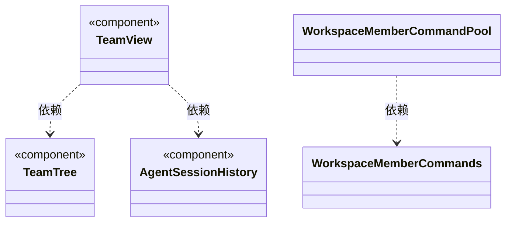

# src/view/team 架构

## 设计意图

展示静态团队、岗位与角色履历。团队图组织角色关系，岗位控制器维护登记命令及回执，历史视图复用执行展示；运行调度留在业务层。

## 主要组成

| 组成 | 定位 |
| --- | --- |
| [WorkspaceMemberCommands](workspace-member-state.ts) | 维护工作区岗位登记的持久命令与回执核对。 |
| [WorkspaceMemberCommandPool](workspace-member-state.ts) | 在团队页签之间复用岗位命令控制器，不随视图卸载丢弃未决记录。 |
| [TeamView](TeamView.tsx) | 静态团队架构、知识编辑与人才市场入口；独立打开角色 Session 履历和项目岗位登记。 |
| [TeamTree](TeamTree.tsx) | 从静态团队模型显示团队、小组和自定义 Agent，配置文件只在详情查看。 |
| [AgentSessionHistory](AgentSessionHistory.tsx) | 在静态 Agent 下浏览长期 Session 履历，按独立会话和运行展示公开消息、工具过程与计划证据。 |

<!-- architecture:generated:start -->

## 架构关系

[上层设计](../ARCHITECTURE.md)

<!-- architecture:generated:end -->
