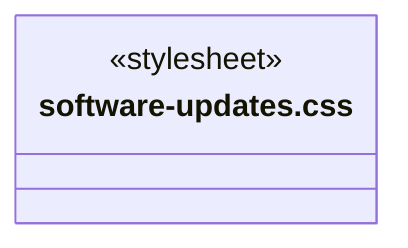
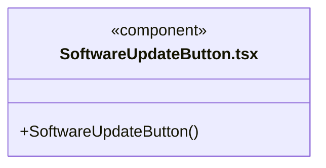
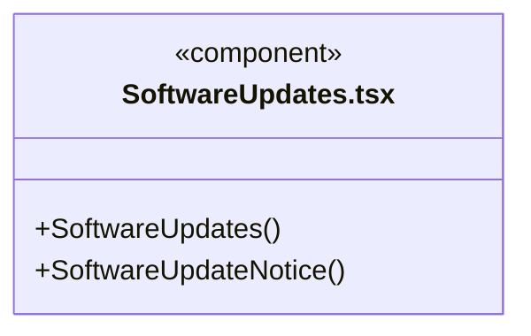
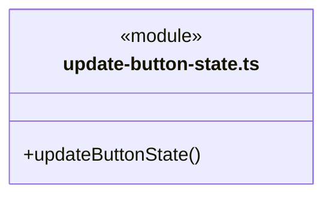
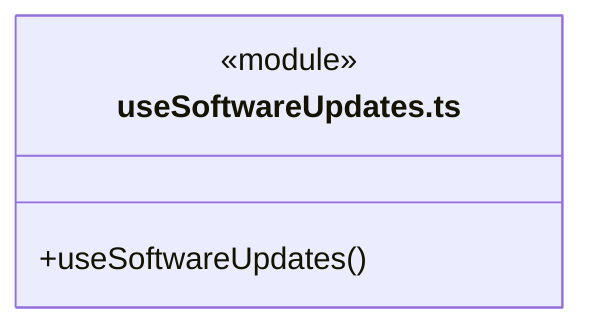
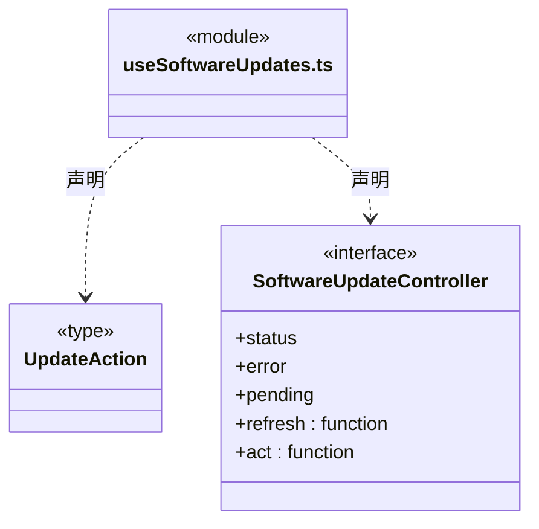
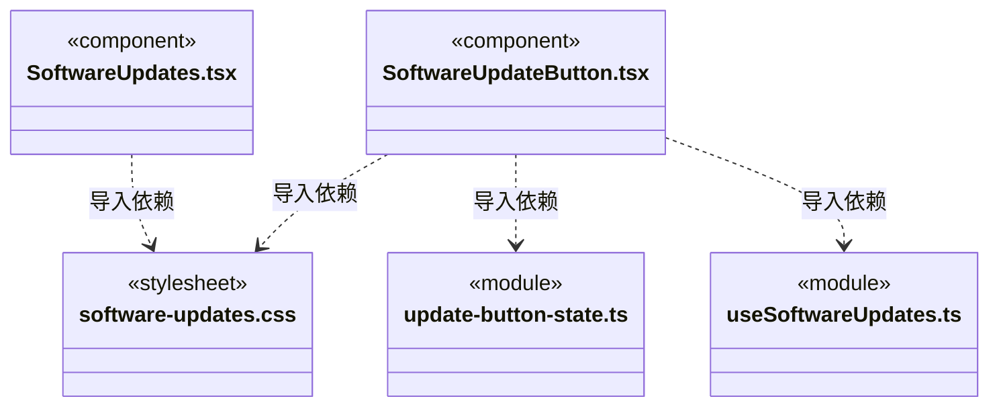
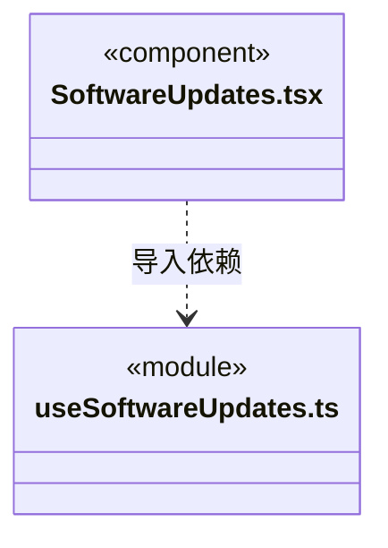

# src/view/updates 架构

本目录只维护这一份说明。设计与契约直接编辑本文；文件清单、类图和导航由 [架构脚本](../../../scripts/source-architecture.mjs) 更新，生成区域之外的人工说明会保留。

## 封装意图

侧栏应用 C/R 更新图标、版本 tooltip 和显式重启安装；独立引擎管理由对话下拉菜单负责。共享窗口级应用更新快照，不因引擎准备显示应用安装就绪。

## 类与模块的设计意图

下表依据源码声明及文件头说明定位封装。字段表示该实例持有的状态或协作引用，不表示它拥有被引用服务的生命周期；实际资源责任和调用限制见下文契约及源码注释。

| 类／模块 | 实现形式与实例字段 | 封装依据 |
| --- | --- | --- |
| [SoftwareUpdateButton.tsx](SoftwareUpdateButton.tsx) | 组件模块 | 入口常驻而不占用菜单；未就绪时仍可键盘聚焦查看状态，但不会下载、排队或安装。 |
| [SoftwareUpdates.tsx](SoftwareUpdates.tsx) | 组件模块 | 弹窗不切换全局页面，保留对话与表单草稿；只消费同一份状态，日志作为纯文本展示。 |
| [update-button-state.ts](update-button-state.ts) | 函数／契约模块 | 下载百分比到 100 不等于校验就绪；安装资格只认后端 ready，错误与未知进度明确展示；引擎准备仅在对话引擎菜单显示。 |
| [useSoftwareUpdates.ts](useSoftwareUpdates.ts) | 函数／契约模块 | 入口切换不重建轮询或下载状态；只读本机 IPC，联网检查、下载、安装仍由独立 updater 负责。 |

## 接口设计契约

### 侧栏版本图标与更新详情

详情中的查看更新、稍后和重试使用公共 Icon，辅助文字至少 12px。既有升级进度图形和专业 Tooltip 保持独立，公共帮助不会覆盖已有 aria-describedby；系统减少动效统一覆盖装饰动画，下载百分比仍只来自真实快照。

本目录拥有侧栏更新图标、tooltip、详情与窗口级 IPC 读取，后端状态机仍在独立 `logic/updates/service`。`shell/App` 每个窗口只挂载一次 `useSoftwareUpdates`，用户栏右侧图标、新版提醒和弹窗共享同一快照；账户登录不是查看版本的前提。原主题按钮的位置用于更新图标，主题切换保留在账号菜单中；菜单不再重复版本与更新项。

`SoftwareUpdateButton` 用向上箭头表示升级，悬停或键盘聚焦通过视口内的 portal 显示当前版本、目标版本、准备进度和错误，不执行检查、下载或安装。`updateButtonState` 只派生展示和操作资格：enabled、有候选、phase=ready 且无在途操作才允许安装。按钮使用 aria-disabled 保留键盘查看状态的能力，点击与 Enter/Space 都经过同一 ready 判断，不将提前点击排队到下载结束。点击就绪图标直接提交一次 install，不额外打开确认弹窗；tooltip 说明会结束任务和重启，并提醒保存编辑。

下载的环形进度最多显示 99，只有后端已验证 ready 才显示完整环和呼吸动画；百分比未知时显示不定进度弧线。检查和应用期间无安装资格；应用失败返回 ready 后必须再次显式点击。减少动态效果设置下关闭转动和呼吸，仍保留满环及文字状态。tooltip 支持 Escape 关闭、边界避让和动态进度更新。

版本使用公开的 desktopVersionLabel：旧安装包显示 vX.Y.Z；提供资源版本时显示 C X.Y.Z / R N，当前与目标分别取后端快照，不因发现候选就提前改变当前版本。

独立 E 的版本、安装、更新和进度统一迁入对话 EnginePicker；应用更新按钮只显示 C/R 状态，不受 E 下载影响。旧 enginePreparations 投影保留通信兼容，不再作为此界面的展示或安装依据。
本目录只展示 CBIM 应用的 C/R 更新。旧冷宿主返回的 enginePreparations 兼容字段一律忽略，不显示引擎名称、准备百分比或失败，也不因此转动更新图标。引擎下载、状态和操作统一由设置中心的引擎详情承载；即使引擎正在准备，应用更新仍只按自己的 phase/progress/ready 工作。

`SoftwareUpdateController` 只公开状态、错误、在途标志和固定 check／download／install 动作。每秒轮询的 status 仅为本机读取；后台定时 GitHub 检查继续属于后端。操作前后推进读取代际，丢弃较旧的在途快照；同一窗口不重复派发操作，下载期间仍读取进度。读取失败有可见提示和重读入口，关闭弹窗不取消后端下载，卸载 App 后不更新 React 状态。

`SoftwareUpdates` 使用原生 dialog 的焦点约束，Escape／关闭后返回原入口。查看日志只打开弹窗，不切换外壳页面，不丢弃聊天、附件、知识或设置草稿。没有已知新版时直接展示当前安装版内置日志；有新版时明确区分可用版本的发布说明与当前版本日志。远端正文按纯文本渲染，不执行 HTML、链接或脚本；没有日志显示明确空态。

统一“版本与更新”弹窗展示日志、状态和手动检查；后台每分钟检查及预下载归后端。下载不停止任务，关闭弹窗不取消下载。ready 表示包已校验并等待用户确认；正常就绪显示“重启安装”，上次安装失败时显示“重试安装并重启”。点击安装前提醒保存未提交编辑，并说明会停止任务和重启。前端不根据 ready 自动派发 install；仅用户明确点击时发出。下载失败提供“重试下载”，仍只准备包。只有重启后的真实 currentVersion / currentResourceVersion 才证明相应 C/R 升级成功。

离线等检查错误在 tooltip 与详情显示，不主动弹出模态框或全局错误。横幅“稍后”只隐藏该版本提醒，不取消检查或移除常驻图标的就绪提示；已授权流程进入 installing 时重新显示进度且没有“稍后”。普通退出取消仍由 Bridge 桌面宿主与 Logic/Application 处理。详情继续从新版提醒打开，关闭后返回真实原按钮；图标未就绪时只显示状态。

菜单与弹窗呈现受用户交互需求驱动；后台预下载和显式安装策略归 logic/updates/service 的状态机，界面只提交一次用户意图并读取进度。没有足够历史数据量化变化频率；后续调整日志排版修改此目录，调整账号菜单只改 shell，安装策略修改 updater 和契约。固定源、制品校验及业务排空机制继续复用，不引入跨功能全局状态或通用基类。

#### 下载计量展示

下载进度字段缺失时显示不定 progress 和“进度待确认”；提醒不附加虚构的 0%。只有实际返回百分比才展示数值，界面不由时间推算下载完成。安装许可与重启入口仍按原 phase 判断。

#### 统一排版（2026-11-16）

普通文字、按钮、状态和说明复用 components/interface.css 的 --font-ui 与 --weight-regular；结构短标题使用 --weight-medium。颜色和间距承担次要信息层级，不把说明文字缩小。代码使用 --font-code，真实 Markdown 标题保留语义层级。

## 开闭边界

本目录的职责及允许协作由[封装意图](#封装意图)限定，输入输出、状态与失败语义以[接口设计契约](#接口设计契约)为准。扩展从已有公开入口及实际装配位置进入；没有明确可替换契约的部分按真实影响修改和验证，不预建未使用的基类或插件入口。

<!-- architecture:generated:start -->

## 文件清单

| 文件 | 形式 | 当前职责 |
| --- | --- | --- |
| [ARCHITECTURE.md](ARCHITECTURE.md) | 说明文档 | 本目录的文件清单、真实声明、依赖与子封装导航。 |
| [SoftwareUpdateButton.tsx](SoftwareUpdateButton.tsx) | 组件模块 | 侧栏用户栏右侧的更新图标，提供版本 tooltip、真实准备进度和显式安装操作。 |
| [SoftwareUpdates.tsx](SoftwareUpdates.tsx) | 组件模块 | 新版提醒的更新详情，展示发布日志、后台准备及显式重启安装入口；侧栏图标独立常驻。 |
| [software-updates.css](software-updates.css) | 样式 | 更新图标、悬浮状态、进度环及更新详情；浮层不受侧栏或工作区裁切。 |
| [update-button-state.ts](update-button-state.ts) | 源码模块 | 把后端更新快照转换为侧栏图标的版本、进度和点击语义，不持有下载状态。 |
| [useSoftwareUpdates.ts](useSoftwareUpdates.ts) | 源码模块 | 由桌面外壳持有的一份更新状态，供侧栏图标、提醒与更新详情共同消费。 |

## 架构类图

成员标记：`+` 公开、`-` 私有、`#` 受保护、`$` 静态；`function` 为函数值成员，`get`／`set` 为访问器。调用／构造／索引签名按匿名签名列出，不虚构方法名；`global.` 表示全局声明补充，非运行时嵌套类。构造函数单独列出，运行时私有字段保留 `#`。文档和资源仅在文件清单中导航，不作为代码节点。

### software-updates.css

[查看源码](software-updates.css)。

### SoftwareUpdateButton.tsx

[查看源码](SoftwareUpdateButton.tsx)。

直接依赖：[../components/Icon.tsx](../components/Icon.tsx)、[software-updates.css](software-updates.css)、[update-button-state.ts](update-button-state.ts)、[useSoftwareUpdates.ts](useSoftwareUpdates.ts)。

### SoftwareUpdates.tsx

[查看源码](SoftwareUpdates.tsx)。

直接依赖：[../../bridge/contracts/desktop-updates.ts](../../bridge/contracts/desktop-updates.ts)、[../components/Icon.tsx](../components/Icon.tsx)、[software-updates.css](software-updates.css)、[useSoftwareUpdates.ts](useSoftwareUpdates.ts)。

### update-button-state.ts

[查看源码](update-button-state.ts)。

直接依赖：[../../bridge/contracts/desktop-updates.ts](../../bridge/contracts/desktop-updates.ts)。

### useSoftwareUpdates.ts

[查看源码](useSoftwareUpdates.ts)。

直接依赖：[../../bridge/contracts/desktop-updates.ts](../../bridge/contracts/desktop-updates.ts)。

### 本目录调用边界

## 子目录导航

无子目录。

[返回上层](../ARCHITECTURE.md)。

每次修改本目录代码，同步维护文件头、关键契约说明及本图。未实现的治理、证据验收和自动编排能力不列入当前类图。

<!-- architecture:generated:end -->
