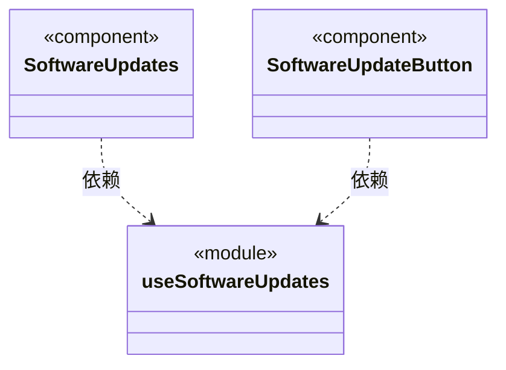

# src/view/updates 架构

## 设计意图

侧栏应用 C/R 更新图标、版本 tooltip 和显式重启安装；独立引擎管理由对话下拉菜单负责。共享窗口级应用更新快照，不因引擎准备显示应用安装就绪。

## 主要组成

| 组成 | 定位 |
| --- | --- |
| [SoftwareUpdates](SoftwareUpdates.tsx) | 新版提醒的更新详情，展示发布日志、后台准备及显式重启安装入口；侧栏图标独立常驻。 |
| [SoftwareUpdateButton](SoftwareUpdateButton.tsx) | 侧栏用户栏右侧的更新图标，提供版本 tooltip、真实准备进度和显式安装操作。 |
| [useSoftwareUpdates](useSoftwareUpdates.ts) | 由桌面外壳持有的一份更新状态，供侧栏图标、提醒与更新详情共同消费。 |

<!-- architecture:generated:start -->

## 架构关系

[上层设计](../ARCHITECTURE.md)

<!-- architecture:generated:end -->
