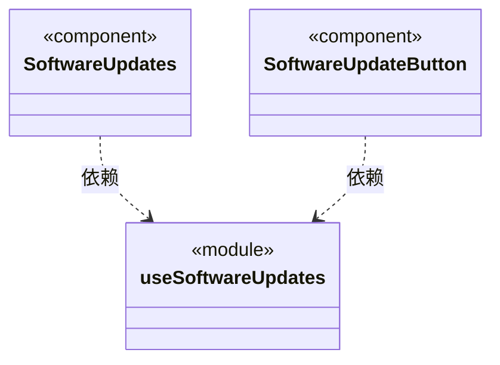

# src/view/updates 架构

## 设计意图

展示应用版本、准备进度和明确重启安装入口，将更新状态与引擎包管理区分。

`useSoftwareUpdates` 连接外壳持有的共享快照，常驻按钮和详情消费同一份状态；纯投影决定 tooltip、进度及可用动作。准备完成不自动安装，引擎包的准备也不能被显示为应用更新就绪。

## 主要组成

| 组成 | 定位 |
| --- | --- |
| [SoftwareUpdates](SoftwareUpdates.tsx) | 新版提醒的更新详情，展示发布日志、后台准备及显式重启安装入口；侧栏图标独立常驻。 |
| [SoftwareUpdateButton](SoftwareUpdateButton.tsx) | 侧栏用户栏右侧的更新图标，提供版本 tooltip、真实准备进度和显式安装操作。 |
| [useSoftwareUpdates](useSoftwareUpdates.ts) | 由桌面外壳持有的一份更新状态，供侧栏图标、提醒与更新详情共同消费。 |

<!-- architecture:generated:start -->

## 架构关系

[上层设计](../ARCHITECTURE.md)

<!-- architecture:generated:end -->
