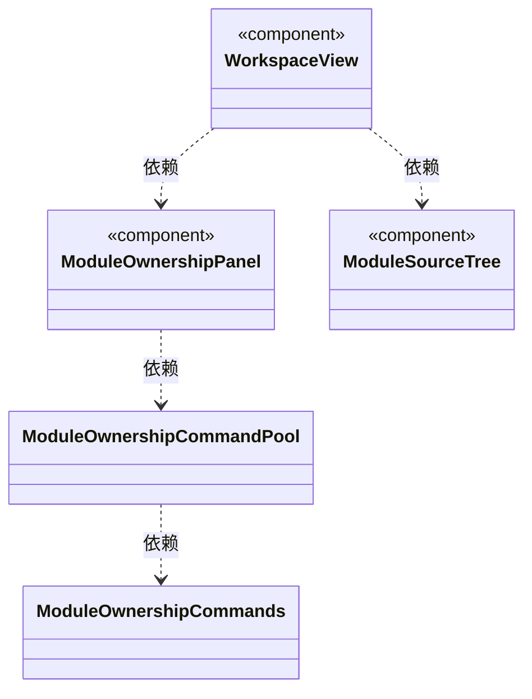

# src/view/workspace 架构

## 设计意图

展示工程、模块与各自 Workflow，并提供负责人管理和源码浏览。模块图负责组织关系，责任控制器管理明确命令，知识编辑与资源复用交给对应页面模块。

## 主要组成

| 组成 | 定位 |
| --- | --- |
| [ModuleOwnershipCommands](module-ownership-state.ts) | 维护模块负责人操作的持久原命令与回执核对。 |
| [ModuleOwnershipCommandPool](module-ownership-state.ts) | 在业务架构与岗位视图之间共享负责人命令控制器。 |
| [WorkspaceView](WorkspaceView.tsx) | 业务模块与绑定源码的目录树、只读源码预览及配置治理入口。 |
| [ModuleOwnershipPanel](ModuleOwnershipPanel.tsx) | 业务架构和项目岗位共用的模块责任控制面，提供岗位选择、登记入口、预览、明确提交和原命令核实。 |
| [ModuleSourceTree](ModuleSourceTree.tsx) | 业务模块语义树及其绑定源码目录的按需浏览。 |

<!-- architecture:generated:start -->

## 架构关系

[上层设计](../ARCHITECTURE.md)

<!-- architecture:generated:end -->
